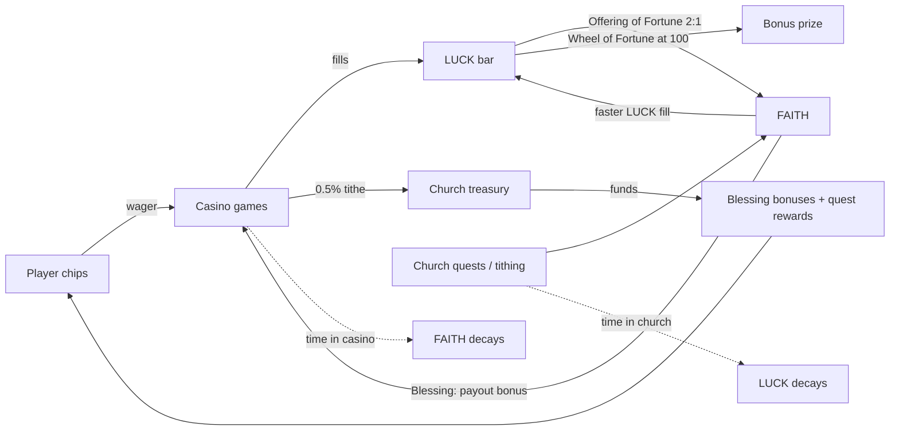
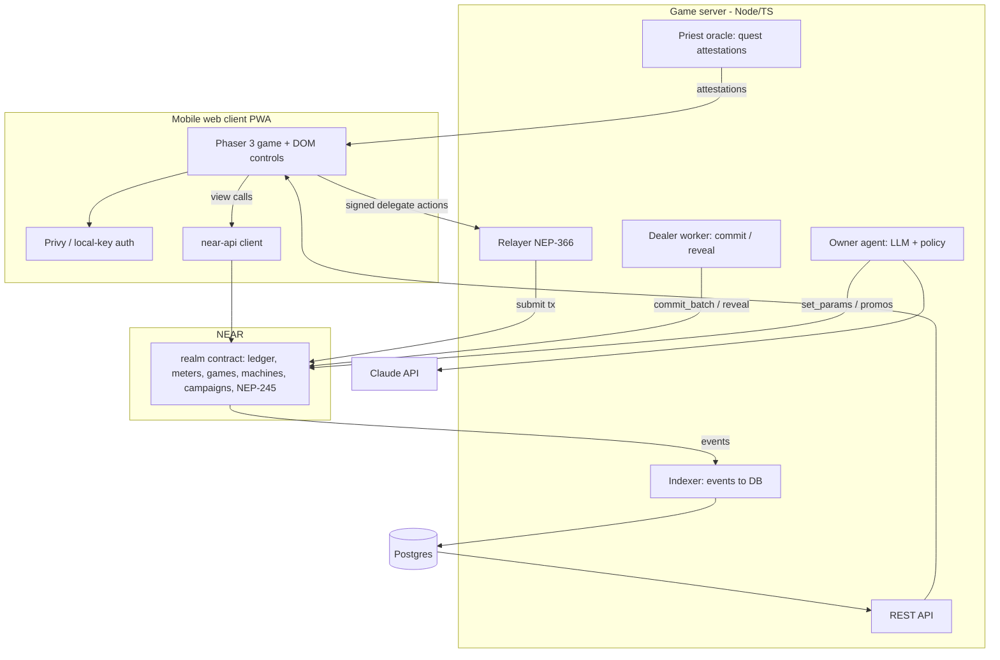

# The Casino & The Church — Master Plan

## Build status — tenth pass (blackjack + the AI hosts, client side)
- Blackjack table panel; dice FIELD; roulette dozens and 2:1 columns. The mock plays every rule of the contract offline.
- The AI hosts in the client:
  - House Monitor: Don's CCTV wall, as CRT screens.
  - The Ledger: an open book on the Father's lectern.
  - The Word at the Crossroads: a split rivalry board south of the road, with a live ticker.
  - Happy Hour and Vigil pills in the HUD; the gates pulse during an event.
  - The hosts say their latest real decision when you talk to them.
  - Tour lines introduce the monitor and the ledger.
  - "How the AI is kept honest", and an in-browser verifier that re-hashes the exact bytes, recovers the EIP-191 signer and checks it against the hardware attestation.
- NEAR AI Cloud signing was verified live (`Qwen/Qwen3.8-27B`, provider_tee). A real signed decision ships as `apps/client/src/ui/ai-sample.json` (the server test fixture is `apps/server/test/fixtures/nearai-decision.json`). Round 3 for the backend agent is in `BACKEND_PLAN.md`.

## Build status — ninth pass (the revamp)
- **Game panels rebuilt as physical casino/church furniture** (`ui/games.ts` + `ui/games.css`): slot cabinet with scrolling reels, payline, lever and marquee; roulette with a real single-zero wheel + ball and a felt betting layout with chip tokens and coloured-ball history; 3D coin (crown = heads, cross = tails); 3D dice on felt with bet zones; Wheel of Fortune and Harmony Wheel as spinning wheels; teller window cashier; offering chest; candle niche; parchment quest cards; altar meters; deed-certificate plots. Shared YOU WIN / YOU LOSE / BET RETURNED / JACKPOT result overlay with count-up and coin burst. Digits now use a dedicated clear numeral face ("Num") because both pixel fonts made 2/5/8 and 4/+ ambiguous.
- **World re-authored** (`world/layout.ts`, no coordinate-compaction maps): casino zoned around the east entrance (cashier + slots + coin flip by the door), Wheel of Fortune as the centrepiece on a marble dais, one carpet with marble platforms instead of a rug patchwork, one roulette + one blackjack, dice den, founders' row with holographic "your machine here" ghosts, lounge & bar; the **Harmony Wheel stands at the Crossroads** (replacing the fountain/market); the church is cross-shaped with the altar at the head of a north-south nave, pews, pillars, quest board/candles/offering by the door, sanctum, scriptorium, pilgrims' hall, cloister.
- Wall caps drawn in each realm's material with contact shadows (no more white bars); darker casino grade so neon pops; one label per place, dim until you walk near; tours rewritten for the new stops (both verified end to end).

## Build status — eighth pass (backend handoff)
- `BACKEND_PLAN.md` written for the contract/backend agent (supersedes PLAN §9-§11 where they differ; deltas D1-D12 listed there). `scripts/rtp_check.py` holds the canonical maths and conformance vectors; `apps/client/src/core/rules.ts` mirrors them and matches (checked). All panels now go through `core/backend.ts` (`Backend` interface + `MockBackend`), which `ChainBackend` will replace.
- New client features: Dice Den and Roulette panels, Founders' Plots (claim gate, name, skin, bankroll; the machine appears on the floor and the sign shows its name), blessing tiers applied to payouts, lazy LUCK/FAITH decay, canonical slot table (RTP 93.97%).

## Build status — seventh pass (playable panels, mock results)
- `ui/games.ts`: Slots (3 reels, demo odds), Coin Flip, Cashier (mock tNEAR<->chips, faucet), Offering Box (tithe -> FAITH, church pool), Votive Candles (cooldown), Quest Board (5 quests tracking real actions), Altar (LUCK->FAITH + Harmony wheel at 50/50), Wheel of Fortune (needs LUCK 100). All go through `store.change()` and persist locally; the contracts replace that single seam. Red exit button top-left (closes a panel, else asks to leave). Dice Den and Founders' Plots are still stubs.

## Build status — sixth pass (controls)
- The whole scene is the control surface: tap = pathfind there (tapping a prop/host walks up and opens it); press+drag = floating joystick; two small buttons (ACT, hold-to-run) bottom-right. The fixed D-pad is gone. Floating HUD pills, static patrons, planter barriers at the Crossroads, Dice Den replaces the vault.

## Build status — fifth pass (scene polish)
- Player lands in the middle of the Crossroads with CASINO/CHURCH direction signs; onboarding is now name -> character -> ENTER (realm step removed); tours start on first entry through each realm gate.
- Cashier moved to the casino's north wall, facing the boulevard, with a neon sign; office shrunk; old cashier area is now the Vault.
- Church stations separated: votive candles (NW), offering box (north, own rug), quest board (south, by the scriptorium).
- Area tags added to every zone; only the player, Don Fortuna and Father Nakamoto are scaled up; camera zoomed out; skip-tour pill removed (Menu has "Skip current tour").


> A 2D pixel-art, top-down RPG for **mobile landscape**, built on **NEAR**.
> Two realms. One economy. Balance is survival.

| | |
|---|---|
| **Status** | Pre-build. Planning document v1.0 |
| **Author** | Solo founder + Claude Code |
| **Primary goal** | Win a place in **Track 09: Games With Real Economies** at NEAR HACKATHON 2026 (submission deadline **14 Nov 2026, 23:59 UTC**) |
| **Secondary goal** | Become the technical + narrative foundation for a post-hackathon raise |
| **Network (hackathon)** | NEAR **testnet** (play-money), mainnet-ready configuration (see §17 Compliance) |
| **Document rule** | Anything marked **[VERIFY]** is an assumption to confirm on the day it is needed. Anything marked **[DECISION]** needs an explicit choice from the founder. |

---

## Build status (updated 9 Nov 2026, fourth pass)

**Fourth pass (playtest 3):** spacing reduced to "a little more than the packed version"; machines grouped in small clusters (slots = 2 pairs, one roulette, one craps, two blackjack, one poker); the world shrank from 120×42 to **106×36**. The **Crossroads plaza is now 24 tiles wide** (was 14) and visibly open-air: lawns, cobbled squares, flower beds, lamps, fountain, valet + limousine on the casino side, market stalls on the church side, direction signs. Tunable in `config.ts` / `layout.ts`.

**Mobile zoom bug, diagnosed from the founder's screenshot:** the whole *page* was zoomed ~1.5× (HUD gone, D-pad 1.5× its size, dark band from overscroll), i.e. the browser's page zoom, not the game camera. Trigger: advancing dialogue with ✕ while the D-pad is held = two simultaneous touches = an iOS pinch. Fix: every multi-touch cancelled at `touchstart`/`touchmove`, game surface touches cancelled, gesture events cancelled, double-tap cancelled, `touch-action` set, and a watchdog that detects `visualViewport.scale != 1` and resets the viewport meta immediately. **Needs a real-iPhone check.**

## Build status (third pass: a real scrolling world)

**Third pass, after the second playtest** ("props jam-packed, scene not great, tour just keeps going, assets under-used, camera zoomed and stuck on mobile").

| Feedback | Change |
|---|---|
| Scene should fill the viewport below the HUD; camera follows the player | The world is **120×42 tiles (1920×672 px)** and scrolls. The canvas fills everything under the HUD bar. Integer device-pixel zoom (≈1.6 CSS px per art pixel on phones, up to 2.4 on big windows) so props are **~70% larger** and crisp. The camera is driven inside `update()` so DOM labels never lag |
| Props jam-packed | Re-laid out with generous spacing: slot **pairs** with 2-tile gaps and an aisle runner, table-pit islands with 3-tile aisles, separate zones each with its own floor, rugs and roads |
| Casino/Church separation + clear titles | New neutral **Crossroads plaza** (cols 53..66) between two walls. A carpet road crosses it. Neon **THE CASINO** and gold **THE CHURCH** signs hang over the doorways; the HUD badge reads THE CASINO / THE CROSSROADS / THE CHURCH. Realms can extend west/east |
| Confirm before entering a realm | Stepping into a doorway from the plaza opens an **"Enter the Church? / Stay out"** popup (keyboard: ✕ / ○) and locks the player. "Stay out" puts you back in the plaza |
| Tour wasn't a real tour | Now a **follow-me tour**: the host walks only while you are within ~8 tiles, calls you back with rotating lines if you drift, waits for you before speaking, a pulsing **marker ring** shows what it is pointing at, and it cancels if you leave the realm. Verified: guide moved 0 px while the player was far away |
| Message box overflowed / too big | Rebuilt: fixed width measured up-front, **name plate**, word-wrapped, `▼` continue marker, clamped to the screen, flips below the speaker near the top |
| Assets under-used | Now using: fountain, valet stand, limousine/taxi/supercar, palm trees and street lamps (plaza), vault + laser grid + security desks + ATMs + cash carts, stage/piano/booths/bar, VIP gallery, scriptorium (library), pilgrims' hall (tavern hearth, kegs, tables), cloister garden (herb beds, well), crypt tombs, dormitory beds, market stalls |
| Mobile: zoomed in by itself and stuck | Hardened: meta viewport locked, pinch/double-tap/ctrl-wheel zoom blocked, no auto-focus on the name field (the soft keyboard resized the window), resizes debounced and ignored while typing, and a **watchdog** that re-syncs the canvas/zoom to the real window every 0.5–0.7 s. Root cause not reproducible in a headless browser, so this needs a real-phone check |

**Verified headless (touch emulation, 844×390 @3×):** follow camera, tour strictness, realm popup, music switching, canvas self-heal after a forced wrong size. **Not verified:** a physical phone, audio by ear.

## Build status (second pass)

**Second pass: rebuilt after the first playtest (rated 1/10: zoomed in, blurry, no layout, big controls, tour needed standing in a spot).**

| Problem reported | Root cause | Fix |
|---|---|---|
| "Zoomed in", can't see both worlds | The camera showed ~14 tile-rows of a 96×32 map and scaled with window height, so big windows got a 6–8× zoom | World redesigned as a **compact 49×23 diorama**. The camera always **fits the whole world** on screen (fractional zoom at device resolution) |
| Everything blurry | Text was drawn into a low-res canvas then scaled up | Canvas renders at **device resolution**. All text (names, prompts, bubbles, signs, HUD) is **DOM text**, crisp at any size |
| "No road/walkable layout" | Scattered props, no structure | **Main Street** runs through the boundary door; a 3-wide **Gate Road** per realm; Marquee Avenue and the Nave. Roads are one framed carpet (borders only on the outside) |
| Land near the boundary door, host greets you | Spawn was far away | Both entrances sit ~7 tiles either side of the boundary door; the host stands on the gate road |
| Tour needed standing at a point | The host waited for you to come within range | Tour **starts by itself** on entering a realm (at the gate, or at the boundary door on first crossing). The host never waits more than a few seconds |
| Controls huge, block the scene | Sized from window height, always opaque | Smaller, **fade when idle**, hidden on desktop (touch devices only; menu toggle). HUD is a slim top bar and the world is drawn **below** it |
| Music | n/a | `main` from the first tap through onboarding; `casino` / `church` per realm; crossing the door fades one out and the other in. Hit sound on buttons. Roulette and slot sounds are in `public/audio` for the panels |
| Onboarding background | Scrolling attract camera | Static full-screen backdrop; each screen auto-scales to fit (never scrolls or clips) |

**Verified headless (software GL, touch emulation) at 667×375, 844×390, 932×430, 1440×800, 1440×900. Not yet verified on a physical phone or by ear.**

## Build status (first pass)

**Phase 0 and Phase 1 (the scene) are built and verified in a headless browser with mobile touch emulation.**

| Area | State |
|---|---|
| Asset pipeline (`scripts/build_assets.py`) | Done. Packs 4,439 frames into 2 atlas pages, cuts 203 animations, builds 32 character sheets |
| World | Done. 96×32 tiles: casino hall, church, centre wall with a walk-through door, owner's office, priest's sanctum. About 330 props, light glows, stained-glass shafts, dust motes, per-realm colour grade |
| Controls | Done. PlayStation-style cross on the left, four face buttons on the right, multitouch, haptics, keyboard fallback |
| HUD | Done (mock values). LUCK/FAITH meters, chips, realm badge, tour pill, menu |
| Onboarding | Done. Title, name, 12-character grid with live walk preview, realm choice with scene thumbnails |
| NPCs + dialogue + tours | Done. Don Fortuna (`pit_boss`) and Father Nakamoto (`monk`) greet at the chosen entrance and lead a pathfound tour. About 20 ambient patrons |
| Interaction prompts, door animation, realm-crossing banner | Done |
| Panels (slots, coin flip, wheel, cashier, plots, altar, offering, missions, candles) | **Stubs.** Each opens a "coming next phase" sheet |
| Contracts, backend, auth, relayer | **Not started** (next phase; plan to be handed to a second agent) |

**Corrections to the plan above, learned from the real art:**
- Characters are **16×32**, 4 frames per direction, with idle, walk, talk, wave and point animations (not 16×24).
- The chapel pack **does** include a standalone altar (48×32, animated candles) and stained-glass wall tiles; we did not need to draw either.
- Chandeliers, pillars and the "FOR SALE" boards are the only pieces we draw ourselves so far (a procedural stone pillar and code-drawn boards).
- The Harmony Wheel (§3.5a) is not placed yet. Plan: a gold-tinted `money_wheel` beside the centre door.

**Still to do on the visual side:** placeholder art so a clean public clone runs without the licensed packs (§6.4), real-device performance check, audio, wheel/slot/coin-flip panel UIs, the Harmony Wheel prop.

---

## Table of contents

1. [Vision & pitch](#1-vision--pitch)
2. [Hackathon strategy](#2-hackathon-strategy)
3. [Game design](#3-game-design)
4. [The scene (build this first)](#4-the-scene-build-this-first)
5. [Mobile-landscape UX & controls](#5-mobile-landscape-ux--controls)
6. [Art direction & asset pipeline](#6-art-direction--asset-pipeline)
7. [System architecture](#7-system-architecture)
8. [Client architecture](#8-client-architecture)
9. [Backend services](#9-backend-services)
10. [Smart contracts](#10-smart-contracts)
11. [Authentication, wallets & gasless play](#11-authentication-wallets--gasless-play)
12. [Storage & data model](#12-storage--data-model)
13. [Build order & schedule](#13-build-order--schedule)
14. [Testing & QA](#14-testing--qa)
15. [Submission checklist](#15-submission-checklist)
16. [Risks & mitigations](#16-risks--mitigations)
17. [Legal & compliance](#17-legal--compliance)
18. [Post-hackathon roadmap & raise narrative](#18-post-hackathon-roadmap--raise-narrative)
19. [Open decisions](#19-open-decisions)
20. [Appendices](#20-appendices)

---

## 1. Vision & pitch

### 1.1 One-liner
**A pixel-art RPG where gambling and faith feed each other — run by AI characters with real wallets, on an economy where players can own the machines.**

### 1.2 The premise
Crypto is two things at once. **The Casino** is memecoin madness: lights, luck, fortunes made and lost. **The Church** is belief: whitepapers as scripture, sermons as roadmaps, the promise of freedom through code. *The Casino funds the Church. The Church built the Casino. Neither can live without the other.*

The player is a wanderer between the two realms:

- In the **Casino** they gamble and build **LUCK**.
- In the **Church** they worship, complete quests and build **FAITH**.
- **Time spent in one realm erodes the other.** Gamble too long and faith crumbles. Preach too long and luck runs dry.
- **LUCK fuels FAITH** (luck can be offered at the altar). **FAITH shapes LUCK** (faith blesses your odds and fills your luck faster).

### 1.3 Why this is a real economy, not a token with a skin
Every flow in the game is a flow of real value between real on-chain parties:

- The **house** is a vault funded by seed capital and player losses.
- The **Church treasury** is funded by a tithe on every wager and pays out the blessings and quest rewards that keep players coming back.
- **Players can own casino machines** (an on-chain deed), fund their own bankroll, earn operator fees, and sponsor **Church campaigns** that pay other players to play their machine.
- Two **NPCs hold wallets and act on their own**: the **Casino Owner** (deals the cards, tunes the house) and the **Priest** (attests quests, runs the treasury policy).

### 1.4 Differentiators (the pitch bullets)
1. **NPCs with wallets.** The Casino Owner is an AI agent with a real NEAR account that commits randomness, settles bets and tunes house parameters inside contract-enforced guardrails. Not a mascot; an economic actor.
2. **Provably fair, dealer-signed randomness.** Commit-reveal with on-chain verification and a timeout that protects the player (see §10.5).
3. **The chain is invisible.** Social login, sponsored gas, no wallet pop-ups during play.
4. **A closed, legible economy** with sources, sinks and a visible feedback loop the player can feel in 30 seconds (§3.4).
5. **Player-owned assets** (machine deeds, NEP-245) and **sponsor campaigns**: a built-in monetisation model for the raise (§18).

---

## 2. Hackathon strategy

### 2.1 What the track rewards
From the official page: *"Judged on the game loop, not the token,"* with a bonus if *"players never notice the chain."* Suggested focus areas: **agent NPCs, social login, NEAR Intents, NEP-245.**

### 2.2 How we map to it

| Track signal | Our answer |
|---|---|
| Game loop, not the token | LUCK/FAITH balance loop is the product. Casino games are the means, not the point (§3.4) |
| Agent NPCs | Casino Owner (AI agent + wallet), Priest (oracle + wallet) |
| Social login | Privy path with a no-wallet fallback (§11) |
| NEP-245 | Machine deeds + relics as a multi-token (§10.7) |
| NEAR Intents | **Out of scope for v1.** Roadmap item: multichain deposits to the cashier cage |
| Players never notice the chain | Gasless relayed calls, door transitions hide tx latency, no wallet prompts |

### 2.3 Judging pipeline (design for it)
1. **AI screening first.** Claude Code and Codex check that the project *runs* and *does what the README says*. **Consequence:** the README must be exact. A one-command local run, an `.env.example`, a live demo URL, and an honest "What works / What is stubbed" table (§15).
2. **Human judges** (NEAR, a16z crypto, Dragonfly, Electric Capital, Synthetix, Helius, cyber•Fund). They will see a 60–90 s video and play for a few minutes. **The first 90 seconds of play must be delightful** (this is why the scene and tours come first).

### 2.4 Scope policy
- **Visually dense, functionally narrow.** The halls are packed with props; only the items in the "Working" column of §3.6 are interactive. Everything else carries an in-fiction "Out of Order" or "Under Construction" sign.
- **One submission, honestly labelled.** Roadmap items are described in the README as roadmap, never as shipped.
- **Code must be written since the announcement** (hackathon rule). The repository's first commit must be on/after 1 Nov 2026. This planning document is fine to include.

---

## 3. Game design

### 3.1 Genre & feel
Top-down pixel RPG (Pokémon/Stardew-style movement, 4-direction walk). Short sessions (3–10 min). Dialogue through speech bubbles above NPCs. Mobile-first landscape.

### 3.2 The world: one building, two halls

```
            CASINO (left)                 │ wall │          CHURCH (right)
  ┌──────────────────────────────────────┐│      │┌──────────────────────────────────────┐
  │ west wing ...(extensible)  OFFICE    ││      ││ SANCTUM (priest's room)    stained   │
  │                                      ││      ││                            glass     │
  │  slots   slots   WHEEL   roulette*   │  DOOR   │  candles   ALTAR   offering          │
  │  slots   COINFLIP  bj*   poker*      ││ (walk)  │  pews   pews   pews                   │
  │  FOUNDERS' ROW (6 plots for owners)  ││      ││  mission board   confessional        │
  │  cashier cage          ▲ SPAWN       ││      ││                                      │
  └──────────────────────────────────────┘│      │└──────────────────────────────────────┘
        * decorative / "Out of Order"
```

A thick centre wall separates the halls. A single **Connecting Door** lets the player walk between them. The crossing triggers a short door animation plus a realm change (§3.3), which doubles as cover for transaction latency.

### 3.3 Realms, presence and decay
The player is always *in* exactly one realm. Presence determines which meter decays.

| Realm | Meter that **grows** by activity | Meter that **decays** while present |
|---|---|---|
| Casino | LUCK | FAITH (slow) |
| Church | FAITH | LUCK (slow) |

- **Decay is computed lazily** on-chain: stored as `(value, last_update, realm)` and settled on every state-changing call. No ticking transactions.
- **Offline protection:** settlement applies at most `max_decay_window` (initial: 15 min) of decay per update, so closing the app overnight never wipes a player.
- Door crossing calls `enter_realm(realm)` (gasless, relayed).

### 3.4 The core loop (what the player feels)



**One-sentence version:** gamble to build luck, spend luck at the altar to build faith, use faith to get better odds, and keep moving because staying anywhere too long costs you.

**The meaningful choice** (this is what makes it a game, not a slot machine): when LUCK reaches 100 the player chooses between
- **Spin the Wheel of Fortune** (casino): immediate chip prize; or
- **Offer it at the altar** (church): convert to permanent-ish FAITH that improves every future bet.

**The win condition: Harmony.** Hoarding either meter fails, because each decays while you stand in the other realm. The reward goes to the player who keeps both alive (§3.5a). That makes "balance is survival" a mechanic, not just a tagline.

### 3.5 Stats & currencies

| Stat | Range | Where stored | Earned by | Spent / effect | Decay |
|---|---|---|---|---|---|
| **CHIPS** | u128 (in yoctoNEAR; UI shows chips) | On-chain ledger in the `realm` contract | Winning, quest rewards, welcome grant | Wagers, tithes, machine bankroll | none |
| **LUCK** | 0–100 | On-chain | Wagering (scaled by wager size), wins give a bonus | Wheel spin (100), Offering (2 LUCK → 1 FAITH) | In Church |
| **FAITH** | 0–100 | On-chain | Quests, tithes, offerings | **Blessing tier** (passive payout bonus), gating for ownership/campaigns | In Casino |
| **Reputation** (derived) | — | On-chain counters | Lifetime wagered + lifetime faith earned | Unlocks machine ownership & campaign creation | none |

**Blessing tiers** (initial tuning; configurable within contract bounds):

| FAITH | Title | Payout bonus | Luck fill bonus |
|---|---|---|---|
| 0–24 | Wanderer | 0 | 0 |
| 25–49 | Believer | +0.50% | +10% |
| 50–74 | Devout | +1.50% | +25% |
| 75–99 | Zealot | +2.50% | +40% |
| 100 | Saint | +3.00% | +50% |

> **Funding rule:** blessing bonuses are paid out of the **Church treasury**, not the house or the machine owner. If the treasury is empty the Church is "poor today" and blessings are inactive (the UI shows it). This couples the economy: the casino's volume funds the church, and the church's blessings sustain play.

### 3.5a Harmony (the balance bonus)

When **LUCK ≥ 50 and FAITH ≥ 50 at the same moment**, the player is in **Harmony**.

- **Why a band, not exactly 50/50:** an exact match is almost impossible to hit and feels like a bug. "Both at or above 50" is reachable but hard to *sustain*, because staying in either realm drains the other. The player has to keep crossing the door.
- **Reward:** access to the **Harmony Wheel**, a golden wheel with a **higher prize table** and a small chance at the **progressive Jackpot pool**.
- **Jackpot pool:** a separate, segregated pool funded by 0.25% of every wager, so it grows with play and is never paid out of the house vault by surprise.
- **Limits (contract-enforced):** a cooldown (initial 24 h) per account, and a spin consumes part of each meter (initial 20 LUCK + 20 FAITH). Both stop farming. The prize table's expected value is set by simulation and bounded as a share of wagering volume.
- **Feedback the player can see:** the Connecting Door glows gold and the HUD shows a Harmony badge while the condition holds. The wheel prop stands beside the door.
- **Relationship to the 100-LUCK wheel:** the Luck-100 wheel (casino) and the Harmony Wheel are separate props with separate tables. The Harmony Wheel is the better prize, and it is the one that requires playing both realms.

### 3.6 Activities

| Zone | Activity | v1 status | Notes |
|---|---|---|---|
| Casino | **Slots** ("Lucky Seven") | **Working** | 3 reels, weighted symbols, commit-reveal |
| Casino | **Coin Flip Pit** | **Working** | 50/50 at 1.94× base; double-or-nothing is a stretch |
| Casino | **Wheel of Fortune** | **Working** (P1) | Triggered by full LUCK bar. Fixed prize table with bounded EV |
| Door | **Harmony Wheel** | **Working** (P1) | Needs LUCK ≥ 50 and FAITH ≥ 50. Higher prizes + progressive Jackpot pool (§3.5a) |
| Casino | Cashier cage | **Working** | Deposit NEAR, withdraw chips, welcome grant |
| Casino | Owner's office | **Working** | Talk to the Casino Owner, see live house stats, request promos |
| Casino | Founders' Row plots | **Demo** (P2) | One plot can be claimed to mint a deed and drop a machine |
| Casino | Roulette, Blackjack, Poker, Craps | Decor | "Out of Order" signs; lore text on interact |
| Casino | Hall of Fame board | **Working** (P3) | Leaderboard from indexer |
| Church | **Offering Box** (tithe) | **Working** | Chips → FAITH, diminishing returns, funds treasury |
| Church | **Altar** (Offering of Fortune) | **Working** (P1) | LUCK → FAITH |
| Church | **Mission Board** | **Working** | 3 quest types (below) + the hardcoded sponsor campaign |
| Church | **Candle prayer** (daily) | **Working** | Timing mini-game, small faith, once per day |
| Church | Confessional | **Working** (P3) | Choice-based dialogue with luck/faith trade-offs |
| Church | Sanctum (Priest's room) | **Working** | Priest dialogue, treasury status, blessing info |
| Church | Prophecy pedestal | Decor | Roadmap |

**Church quest types (v1):**

| Type | Example | Verification |
|---|---|---|
| **Social** | "Follow @NEARProtocol", "Share this post with #NEARHackathon" | Priest oracle: tweet-URL check [VERIFY a no-auth route such as oEmbed], else honour-system with a click-through timer. Result is an **oracle-signed attestation** redeemed on-chain |
| **In-game** | "Light 3 candles" (timing mini-game), "Answer the catechism" (quiz about a sponsor) | Server-validated, attested by the oracle |
| **Campaign** | "Play 5 rounds on Mike's Slot" | **Fully on-chain**: play counters per (player, machine) |

Abuse controls: per-account daily caps, cooldowns, one identity-bound welcome grant, and FAITH being **non-transferable and decaying**, so farming it has bounded value.

### 3.7 NPCs

| NPC | Role | Wallet | Behaviour |
|---|---|---|---|
| **Casino Owner** (placeholder name: *Don Fortuna*) | Greets, tours, office host, dealer | Own NEAR account, restricted function-call keys | Commits randomness, reveals/settles bets, tunes house params within guardrails, comments on what it does in character (§9.3) |
| **Priest** (placeholder name: *Father Nakamoto*) | Greets, tours, sanctum host, oracle | Own NEAR account | Signs quest attestations, announces treasury state, sermon flavour (LLM stretch) |
| **Patrons** (2–4 ambient) | Atmosphere | none | Wander/idle; occasional gossip lines |

Names are placeholders. **[DECISION]** confirm final names and personality sheets (§19).

### 3.8 Onboarding: the two tours
- **Casino tour (first spawn).** The Owner meets the player at the Gate, then walks a fixed route to each game station. At each stop a speech bubble appears above the Owner explaining what to do. The player follows with the D-pad. The Owner waits if the player falls behind (> 5 tiles, with a "keep up" line). Ends at the office: *"Come see me here anytime."* Replayable from the Menu.
- **Church tour (first door crossing).** The Priest meets the player at the Connecting Door and walks them through the Offering Box, Altar, Mission Board, candles, and finally the Sanctum.
- Tour completion is stored on-chain as a flag bit in the player record (`tour_flags`) and cached client-side.
- Tours are **data-driven** (waypoints + dialogue lines in JSON) so adding a new station is a content edit.

### 3.9 Progression & ownership
- **Reputation gate** (not a timer): machine ownership requires lifetime wagered ≥ *W* and lifetime FAITH earned ≥ *F* (initial: tuned so a dedicated player qualifies in days; for the demo an admin can grant it).
- **Owning a machine:** pick a type (Slots / Coin Flip), fund a bankroll, name it ("Mike's Slot"), claim a Founders' Row plot. A **deed** (NEP-245 token) is minted; the machine appears in the scene.
- **Operator economics:** per wager, 1.0% goes to the house vault (protocol), 0.5% to the Church treasury, the rest stays in the machine bankroll. The owner profits when players lose more than they win, bears variance, and can withdraw bankroll above a reserve.
- **Campaigns are a Church feature, not a casino-owner perk.** Any player can launch one from the Mission Board. They do **not** need to own a machine. There are two kinds:

  | Kind | Who launches | What players do | Verification |
  |---|---|---|---|
  | **Machine campaign** | A machine owner | Play N rounds on the owner's machine | Fully on-chain (play counters) |
  | **Project campaign** (external) | Anyone with a budget (e.g., a project promoting itself) | Follow, share, try a dapp, answer a quiz about the project | Priest-oracle attestation (§9.4) |

  Both appear on the Mission Board, are funded from the creator's chip budget, and pay chips and/or FAITH per completion. **10% of the budget is tithed to the Church treasury at creation.**

  **Safeguards (required before this is open to the public):**
  - **Malicious-link risk is the main danger.** An open campaign board is a phishing surface inside our game. Campaigns go through a **Church approval step** (moderation queue / allow-list) and show an "outside the Church" interstitial before any external link opens. No campaign may ask for wallet signatures.
  - **A refundable bond** and a minimum FAITH tier (initial: Believer) deter throwaway spam accounts.
  - **FAITH is capped per campaign and per player per day.** FAITH drives the blessing, which the treasury pays for, so a sponsor must never be able to mint unlimited FAITH.
  - **Sybil farming of social quests** is limited by identity-bound accounts, per-account caps and sponsor-set limits. Sponsors accept that off-chain engagement checks are imperfect.
- **v1 demo:** one pre-seeded machine, one hardcoded **machine** campaign and one hardcoded **project** campaign (e.g., "Follow @NEARProtocol") to show both kinds. The open creation flow is built after the demo set works. The contract data model carries the campaign `kind` from day one. See §10.8 for how a real factory fits later.

### 3.10 Game feel requirements
- Every action has audio + visual feedback within 100 ms, even while the chain call is in flight (optimistic animation, authoritative result).
- Spin/flip animations deliberately last long enough (≈1.5–2.5 s) to cover the reveal transaction.
- Failed relays or timeouts degrade gracefully: the bet resolves via the contract's timeout path (§10.5), and the UI says so in plain language.

---

## 4. The scene (build this first)

### 4.1 Technical spec
- **Tile size:** 16×16 px.
- **World map:** 96 × 32 tiles (1536 × 512 px) for v1.
  - Casino: x 0–47. Centre wall: x 48–49. Church: x 50–95.
  - Casino can extend west by adding tiles to the left (design the origin so the Gate is not at x = 0; keep coordinates in a single config).
- **Layers (Tiled):** `ground`, `floor_decor`, `walls`, `props_below` (drawn under player), `props_above` (drawn over player: tall tops), `collision` (object layer), `zones` (object layer), `interactables` (object layer), `waypoints` (tour routes), `lighting` (optional).
- **Depth sorting:** y-sort for the player/NPCs/props so walking behind slot machines looks right.
- **Camera:** follows the player with a dead-zone and clamps to map bounds; subtle lerp.
- **Zones** (objects with a `realm` and `zone` property): `casino`, `church`, `office`, `sanctum`, `door`. Zone enter/exit emits events used for audio crossfade, HUD label and realm presence.

### 4.2 Coordinate sketch (tiles; refine in Tiled)

| Object | Approx. tiles | Notes |
|---|---|---|
| **Spawn / Gate** | (23, 30) | South wall of casino; Owner waits here |
| Cashier cage | (30–35, 26–29) | Deposit/withdraw terminal |
| Slots bank | (8–19, 20–24) | Working: machines #1–#2; others decorative |
| Coin Flip Pit | (22–27, 17–21) | Round table, working |
| Wheel of Fortune | (30–36, 10–15) | Big wheel prop; works when LUCK = 100 |
| Roulette / Blackjack / Poker | (6–20, 8–14) | Decor with "Out of Order" signs |
| Founders' Row | (8–27, 26–28) | 6 plots with "For Sale" signs |
| Owner's office | (38–46, 2–9) | Door at (41, 9); Owner NPC seated at desk; stats monitor |
| Hall of Fame board | (3–5, 3–4) | Leaderboard |
| **Connecting Door** | (48–49, 14–17) | Interact zone both sides |
| Church entrance foyer | (52–58, 12–19) | Priest meets player here |
| Offering Box | (54, 20) | |
| Mission Board | (58–60, 22–23) | Quests + sponsor campaign |
| Candle rack | (62–66, 6–8) | Prayer mini-game |
| Pews | (60–82, 10–26) | Two blocks flanking centre aisle (collision) |
| **Altar** | (88–93, 13–19) | East end of nave |
| Stained glass (wall decor) | (60–90, 0–2) | Animated light shafts (stretch) |
| Confessional | (70–73, 3–7) | Stretch |
| Sanctum | (84–94, 2–9) | Door at (88, 9); Priest NPC |

### 4.3 Scene build checklist (acceptance criteria for Milestone M1)
- [ ] Whole 96×32 map renders at 60 fps on a mid-range phone.
- [ ] Player walks with D-pad and keyboard; collision correct; y-sort correct.
- [ ] Camera follow + clamp; integer-scale rendering, no shimmering.
- [ ] Door crossing with transition; realm label updates; music crossfade.
- [ ] Both NPCs present; speech bubbles above NPCs; typewriter text.
- [ ] Both tours playable end-to-end with the waiting-for-player logic.
- [ ] Interactable hotspots show a ✕ prompt when in range and open a stub panel.
- [ ] HUD shows LUCK/FAITH/CHIPS (mock values until chain is wired).

---

## 5. Mobile-landscape UX & controls

### 5.1 Target devices & rendering
- **Orientation:** landscape only. In portrait show a "Rotate your device" screen. PWA manifest `orientation: landscape`; attempt `screen.orientation.lock()` after fullscreen where supported.
- **Reference sizes:** 844×390 CSS px (modern phones) down to 667×375 (small). Desktop is supported with keyboard.
- **Integer-scale adaptive viewport** (avoids uneven pixels): choose integer scale `s = max(1, round(physicalHeight / 224))`, then logical height `H = floor(physicalHeight / s)` and logical width `W = floor(physicalWidth / s)`. Typical logical size ≈ 400×220 at 16 px tiles. Render pixel-perfect (`pixelArt: true`, `roundPixels: true`, nearest-neighbour).
- **Safe areas:** use `env(safe-area-inset-*)` so controls never sit under notches or the home indicator.
- **No scroll/zoom/selection:** `touch-action: none`, `user-select: none`, `overscroll-behavior: none`, viewport `user-scalable=no`.

### 5.2 Layout

```
┌────────────────────────────────────────────────────────────────────────────┐
│ ┌LUCK ▓▓▓▓░░░┐ ┌FAITH ▓▓░░░░░┐  🪙 1,250        ◉ CASINO       [⚙]  [👛]  │ ← HUD
│                                                                            │
│                                                                            │
│                         GAME VIEWPORT (Phaser canvas)                      │
│                                                                            │
│                                                                            │
│        ▲                                                       △           │
│      ◄   ►                                                   □   ○         │
│        ▼                                                       ✕           │
│   (D-pad, left thumb)                              (face buttons, right)   │
└────────────────────────────────────────────────────────────────────────────┘
```

### 5.3 Controls

**Left: D-pad** (PlayStation-style cross)
- Four arms (↑ ↓ ← →) joined in a cross; each arm ≥ 56×56 CSS px; cluster ≈ 168×168, 24 px from the left and bottom edges (plus safe area).
- Pressing two adjacent arms (or sliding the thumb across the centre) produces diagonal movement; sprites stay 4-directional.
- Hit slop +8 px per arm; the whole cluster tracks one pointer (so sliding between arms never "drops" input).

**Right: face buttons** (PlayStation-style diamond), each ≥ 56 px, ≈ 168×168 cluster, 24 px from the right and bottom edges

| Button | Position | Action | Notes |
|---|---|---|---|
| **✕** | bottom | **Interact / Confirm / Advance dialogue** | Primary; largest glow when an interactable is in range |
| **○** | right | **Cancel / Back / Skip text** | Hold to **run** while exploring |
| **□** | left | **Menu**: stats, quests, replay tours, settings | |
| **△** | top | **Contextual action** | In games: "Max bet" / "Spin again"; in world: quick-travel hint arrow |

**Top bar:** LUCK bar, FAITH bar, CHIPS counter, realm label, settings and wallet/account pill. Compact and non-interactive during play except the two pills.

**Customisation:** control size (S/M/L), opacity, left-handed swap, haptics on/off, "reduce motion".

**Desktop / keyboard:** arrows or WASD to move; `Z`/`Enter`/`Space` = ✕, `X`/`Esc` = ○, `C` = □, `V` = △. Gamepad API support is a stretch.

### 5.4 Implementation notes
- Controls are a **DOM overlay** above the canvas (not drawn in Phaser): reliable multi-touch via Pointer Events, crisp rendering, easy styling, accessible labels. Pixel styling via CSS + sprite sheet (`image-rendering: pixelated`).
- One `InputManager` abstracts keyboard, touch and gamepad into the same action stream: `{move: Vec2, interact, cancel, menu, context}`. The game never reads raw device events.
- Haptics through `navigator.vibrate` (short pulses on ✕ press, longer on win) where available.
- Game panels (slot machine UI, coin flip UI) are Phaser UI scenes. They remap the same buttons: ◄ ► change bet, ✕ spin/flip, ○ leave, △ max bet.
- Large touch targets everywhere; no hover-dependent UI; text ≥ 8 logical px at the integer scale with a pixel font and a high-contrast outline.

### 5.5 Performance budget
- 60 fps on a mid-range Android (reference: a 3–4-year-old mid-tier phone) [VERIFY on real device].
- First load < 5 s on 4G; JS bundle < 1 MB gzipped (excluding Phaser if CDN-cached); atlas textures ≤ 2048².
- All sprites in **texture atlases**; one tilemap draw per layer; object pooling for particles; audio sprites.

### 5.6 Accessibility
- Colour-blind-safe meters (shape + label, not just hue).
- Adjustable text speed; tap-to-skip typewriter.
- Reduce-motion switch disables screen shake and flicker lighting.
- Clear, plain-language errors (no raw RPC messages).

---

## 6. Art direction & asset pipeline

### 6.1 Direction
- **Style:** 16×16-tile, limited-palette pixel art; soft dithering, dark outlines, readable silhouettes. Warm and lived-in, not sterile.
- **Casino mood:** deep purple/near-black carpet, neon magenta and red, gold trim, flickering marquee lights.
- **Church mood:** warm stone, candle amber, wood pews, stained-glass blue/teal/gold light shafts.
- **Shared accent:** gold (ties the two realms together; used for chips, halos, trim).
- **The wall and door** are the visual hinge: one side's light spills onto the other.
- **Lighting:** baked into tiles plus a cheap additive "glow" sprite layer (neon flicker, candle flicker). No real-time lighting.

### 6.2 Proposed palette (starting point; lock after the first scene pass)

| Role | Hex | Role | Hex |
|---|---|---|---|
| Ink / outline | `#14101c` | Stone light | `#b8a58c` |
| Casino carpet dark | `#2a1233` | Stone mid | `#8a7762` |
| Casino carpet mid | `#4a1d52` | Wood pew | `#6b4226` |
| Neon magenta | `#ff2e88` | Candle amber | `#ffb347` |
| Neon red | `#e8394a` | Glass blue | `#3a7bd5` |
| Gold | `#f5c542` | Glass teal | `#2fb8a8` |
| Cream | `#f4ead5` | Holy white | `#fff8e6` |

An established free palette (e.g., from Lospec) is an acceptable base. **[DECISION]** custom vs. adopted palette (§19).

### 6.3 Asset manifest (v1 scope)

| Group | Assets | Size | Priority |
|---|---|---|---|
| **Tilesets** | Casino floor/wall/neon; Church stone/wall/glass; shared doors, rugs, pillars | 16×16 | P0 |
| **Player** | 4 directions × (idle + 3-frame walk) + run variant; 2–3 outfit palettes | 16×24 | P0 |
| **NPCs** | Casino Owner, Priest (4-dir idle + walk), 2–3 patron variants | 16×24 | P0 |
| **Casino props** | Slot machine (idle/spin/win), coin-flip table, wheel of fortune (spin), roulette, blackjack, poker, cashier cage, owner desk + vault + stats monitor, "For Sale" plots, Hall of Fame board, bar/lounge decor | 16–64 px | P0 (working) / P1 (decor) |
| **Church props** | Pews, altar, offering box, candle rack (lit/unlit), mission board, confessional, font, stained-glass windows, banners, pulpit, organ | 16–64 px | P0 (working) / P1 (decor) |
| **UI** | Dialogue 9-slice, speech bubble (with tail), meters (LUCK/FAITH), CHIPS icon, realm badges, D-pad + face buttons (idle/pressed), menu panels, interaction prompt (✕), reel symbols (7, cherry, bell, bar, coin, cross, clover), coin heads/tails | various | P0 |
| **FX** | Coin burst, sparkle, halo glow, neon flicker, candle flame, dust motes in light shafts | small atlases | P1 |
| **Audio** | Casino loop, church loop (organ/choir), UI blips, spin/stop, win jingle, coin clink, door, prayer chime | — | P1 |
| **Font** | Open-licence pixel font (e.g., from Google Fonts) [VERIFY licence] | — | P0 |

### 6.4 Sourcing strategy (honest capability statement)
Claude Code **does not generate raster images natively**. What it can do:

| Method | What I deliver | Quality (my honest rating) |
|---|---|---|
| **Code-drawn pixel art** (scripts that paint sprites from palette-indexed pixel grids into PNG atlases) | Tiles, flat props, icons, UI frames, reel symbols, simple 16×24 characters | **Props/tiles/UI: ~6/10. Character animation: ~4/10. Scene composition: ~6/10** |
| **Curated pack + my adaptation** (recolour to one palette, compose maps, build atlases, write Tiled data) | Cohesive scene on top of a professional base | **~7–8/10** with a good pack |
| **Founder's art tools** (Aseprite/LibreSprite) | Hand-finishing key sprites (hero, NPC portraits) | Best ceiling |
| **AI image generators** | Concept/pitch art for the deck only | Not usable as game sprites (inconsistent grid/palette) |

**Recommended hybrid:** use a licensed base pack for floor/wall/furniture/character bases **[DECISION: which pack; verify each licence allows commercial use, since we will raise on this]**, let me generate the bespoke pieces (slot machine, wheel, altar, signage, UI, reel symbols, door), and hand-polish the hero and the two NPCs. Candidate sources to evaluate: Kenney (CC0), itch.io interior/modern packs, OpenGameArt. Every third-party asset is logged in `assets/LICENSES.md`.

**Decision (9 Nov): buy two bubbabba packs.**
- **Modern Casino** (top-down, 16×16): slots, blackjack/poker/roulette/craps tables, cashier cage, vault, neon signs, doors, floors, walls.
- **Medieval Town** (top-down, 16×16, same artist so the style matches): its chapel set has pews, lectern, stone font, kneeler, **alms box** (our Offering Box), banners, organ, animated altar candles, chapel floor/walls and an arched door.
- **Gothic Cathedral is rejected.** It is a side-scroller. Graveyard is also a side-scroller.
- **Still to draw ourselves:** a standalone altar, stained-glass windows, the Wheel of Fortune and Harmony Wheel, the coin-flip table, Founders' Row signage, the Mission Board and all UI.
- **The founder draws the player and NPC sprites.** Everything else must match their outline weight and palette.

**Licence risk accepted by the founder, recorded here so it is not forgotten.** Both packs' licences forbid use "in NFT or crypto projects" and forbid sharing the assets. Two practical consequences:
1. **Do not commit the raw packs or atlases to the public repo.** The hackathon needs a public repo, and that would be sharing. Keep them in a git-ignored `assets/vendor/` folder and ship the built game through the deployed site only.
2. **A clean clone must still run.** The repo ships generated placeholder art; the private pack overlays it at build time. This also keeps the art swappable if the licence has to be resolved (negotiated or replaced) before a raise.

### 6.5 Pipeline
1. Source art: `assets/src/` (Aseprite/PNG/Python generators).
2. Map: **Tiled** → `assets/maps/world.tmj` (JSON).
3. Build step: pack to atlases (e.g., `free-tex-packer`/`texture-packer` CLI) → `apps/client/public/assets/`.
4. Hot-reload in dev; a `pnpm assets` script rebuilds atlases deterministically.
5. All colours go through the palette file; a lint script flags off-palette pixels.

---

## 7. System architecture



### 7.1 Principles
- **Chain is the source of truth for money and stats.** The server is never trusted with balances.
- **Server is trusted only for:** relaying (cost/abuse control), holding the dealer secret until reveal (and the contract punishes withholding), attesting off-chain quest facts, and running the Owner agent inside contract-enforced bounds.
- **Everything the server can do to the economy is bounded by the contract** (§10.6 guardrails).

### 7.2 Tech stack

| Layer | Choice | Why |
|---|---|---|
| Game engine | **Phaser 3** + TypeScript | Mature 2D, tilemap + atlas support, strong mobile web story |
| Build | **Vite**, **pnpm** workspaces | Fast dev loop, monorepo |
| Maps/art | **Tiled**, Aseprite/LibreSprite, atlas packer | Industry standard |
| Controls | DOM overlay + Pointer Events | Reliable multi-touch |
| State (client) | Small typed event bus + store (e.g., Zustand) | Decouples game and UI |
| Chain client | `@near-js/*` packages [VERIFY current package set on Day 1] | Official JS libs |
| Contracts | **Rust**, `near-sdk-rs` 5.x (pin the version `cargo near new` generates; v6 was announced as upcoming, so check before pinning) [VERIFY], `cargo-near` | Required language choice; official toolchain |
| Contract tests | Unit tests + sandbox integration tests (`near-workspaces` 0.22.x or its successor `near-api-rs` + `near-sandbox-rs`) [VERIFY] | |
| Server | **Node 20+ / TypeScript / Fastify** | Fast to build, shares types with the client |
| DB | **Postgres** (Neon free tier) + Drizzle ORM | Simple, relational, cheap |
| Indexing | RPC polling of receipts/events for the hackathon; NEAR Lake / FastNEAR streaming later | Least moving parts |
| AI | **Claude API** (Sonnet tier for decisions, Haiku tier for dialogue) | Owner agent brain |
| Hosting | Client: Vercel or Cloudflare Pages. Server: Fly.io or Railway | Fast deploys |
| CI | GitHub Actions (lint, test, wasm build) | |
| Observability | Pino logs + a small `/healthz` + agent decision feed | |

### 7.3 Repository layout

```
casino_n_church/
├─ PLAN.md
├─ README.md                  # judge-facing: run steps, what works vs stubbed
├─ apps/
│  ├─ client/                 # Vite + Phaser + TS
│  │  ├─ src/
│  │  │  ├─ main.ts
│  │  │  ├─ config/           # constants, palette, realm params
│  │  │  ├─ scenes/           # Boot, Preload, World, UI, Panels/*
│  │  │  ├─ systems/          # Input, Camera, Interaction, Dialogue, Tour, Audio, Zones
│  │  │  ├─ entities/         # Player, Npc, Interactable
│  │  │  ├─ ui/               # DOM controls overlay, HUD
│  │  │  ├─ chain/            # auth, rpc, relay client, contract bindings
│  │  │  └─ state/            # store + event bus
│  │  └─ public/assets/
│  └─ server/                 # Fastify app
│     └─ src/{relayer,dealer,agent,oracle,indexer,api,db,config}/
├─ contracts/
│  └─ realm/                  # near-sdk-rs crate (modules in §10.2)
├─ packages/
│  ├─ shared/                 # types, constants, game math mirrors
│  └─ sim/                    # RTP / solvency simulator
├─ assets/
│  ├─ src/                    # art sources and generators
│  ├─ maps/                   # Tiled files
│  └─ LICENSES.md
├─ scripts/                   # deploy, seed, assets pipeline
└─ .github/workflows/
```

---

## 8. Client architecture

### 8.1 Phaser scenes
- `BootScene` → `PreloadScene` (atlases, map, audio, fonts, progress bar) → `WorldScene` (map, entities, systems) with a parallel `UIScene` (HUD, dialogue, panels).
- **Panel scenes** launched over the world: `SlotsPanel`, `CoinFlipPanel`, `WheelPanel`, `CashierPanel`, `OfferingPanel`, `MissionBoardPanel`, `MenuPanel`, `OfficePanel`, `SanctumPanel`.

### 8.2 Systems (each independently testable)

| System | Responsibility |
|---|---|
| `InputManager` | Merge keyboard/touch/gamepad into the action stream |
| `PlayerController` | Movement, collision, facing, run |
| `InteractionSystem` | Proximity detection to interactables, ✕ prompt, dispatch |
| `ZoneSystem` | Enter/exit zones, realm presence, audio crossfade, HUD label |
| `DialogueSystem` | Speech bubbles above NPCs, typewriter, queue, skip |
| `TourSystem` | Waypoint routes, wait-for-player, per-stop dialogue, completion flag |
| `NpcSystem` | Idle/wander/schedule, tour leader mode |
| `ChainSession` | Auth state, account id, relayed calls, view caching, optimistic updates |
| `EconomyStore` | Mirrors on-chain player record; interpolates decay between syncs for smooth bars |
| `AudioSystem` | Music layers, SFX sprites, mute |
| `FxSystem` | Particles, neon flicker, candle flicker, screen shake |

### 8.3 Chain interaction pattern
1. User presses ✕ at a game → panel opens, reads current player record (view call, cached 1–2 s).
2. Press spin → client generates a random `client_seed`, shows the spin animation immediately, and sends `place_bet` as a **signed delegate action** to the relayer.
3. Poll (or subscribe via the server's SSE) for the settlement event keyed by `bet_id`.
4. When the reveal arrives, animation lands on the authoritative result; HUD updates.
5. If no reveal within the animation window + grace period → UI shows "Dealer is slow… your bet is protected" and, after `reveal_timeout_blocks`, offers the timeout claim (§10.5).

---

## 9. Backend services

All services start life in **one Node process** with module boundaries so they can be split later.

### 9.1 Relayer (NEP-366 delegate actions)
- Accepts `{ delegateAction, signature }` from the client, validates it, wraps it in a transaction and submits it.
- **Allow-list** of method names; **max gas**; **zero deposit enforced** (see §11.3: the relayer pays any attached deposit, so deposit-bearing methods are never relayed).
- Per-account and per-IP **rate limits** and daily gas budget; deny-list.
- Returns the tx hash; client then follows events.

### 9.2 Dealer worker (commit–reveal)
- Maintains a secret pool: generates `N` random server seeds, stores them encrypted at rest, and posts their SHA-256 commitments in batches via `commit_batch`.
- Watches `BetPlaced` events; for each bet reads its assigned commitment index, calls `reveal(bet_id, server_seed)`.
- **Never** exposes unrevealed seeds. Refills commitments when the pool falls below a threshold.
- Operates under the **Casino Owner NPC's account** (so the NPC visibly "deals" the cards on-chain).

### 9.3 Owner agent (AI Casino Owner)
Two strictly separated layers:

1. **Policy layer (deterministic, safe).** Executes actions with hard bounds: `set_edge(bps)`, `set_max_bet`, `grant_promo(player, amount)` (daily budget), `request_topup`. Rejects anything outside bounds before it ever reaches the chain. The contract enforces the same bounds again.
2. **Persona layer (LLM).** Reads a compact state summary (vault balance, 24 h volume, house P&L, active players, treasury level) and returns a **structured decision** (tool call) plus an **in-character line**. The line is what appears in the speech bubble, so the dialogue is *tied to a real action* ("Vault's down 12%, so I'm tightening the edge to 6%. Don't take it personally.").

Safety rules:
- The LLM output is **parsed as data**; it never executes arbitrary instructions.
- **Player-written text is never fed into the decision prompt.** Free-text chat with the Owner (office) uses a separate read-only persona call with no tools.
- Every decision is logged to `agent_decisions` and exposed via `/agent/feed` and in the office monitor.
- Cadence: periodic (e.g., every few minutes) + event triggers (vault low, big win). Decision changes are rate-limited and have contract-enforced cooldowns.
- **Fallback:** if the LLM is unavailable, a rule-based policy runs and the line comes from a template bank. The game never depends on the LLM being up.

### 9.4 Priest oracle
- Issues **signed attestations** `(player, quest_id, nonce, expires_at)` after validating a quest's off-chain condition (social check, mini-game result, quiz).
- Signs with the oracle's ed25519 key; the contract verifies the signature against the registered oracle public key.
- Also signs the **welcome grant** attestation after the identity check (one grant per verified identity).

### 9.5 Indexer & API
- Reads contract events (`EVENT_JSON` logs) into Postgres: bets, settlements, tithes, quests, deeds, campaigns, params changes.
- REST: `POST /relay`, `GET /player/:id`, `GET /stats`, `GET /leaderboard`, `GET /agent/feed`, `POST /quests/:id/submit`, `GET /bets/:id` (reveal status), `GET /healthz`. SSE `/events/:account` for the client.

### 9.6 Security basics
- Secrets only in server env; `.env.example` committed (no real values).
- CORS locked to the client origin; input validation (zod); structured logging with PII minimised.
- Dealer seeds and agent keys use **function-call access keys restricted to the realm contract** and specific methods wherever possible.

---

## 10. Smart contracts

> Code below is **illustrative** to fix the structure; exact signatures are finalised at scaffold time. Rust, `near-sdk-rs` 5.x. All balances `u128`, serialised as strings (`U128`) in JSON.

### 10.1 Contract topology (hackathon)
**One main contract, `realm`**, holding: the chip ledger, player stats, house vault, Church treasury, games, machines, campaigns, and an embedded **NEP-245** implementation for deeds/relics. This avoids cross-contract asynchrony (the biggest source of bugs under deadline). Modules keep boundaries clean so a later split is mechanical.

Accounts (testnet examples): `realm.<you>.testnet` (contract), `boss.<you>.testnet` (Casino Owner NPC: dealer + agent keys), `priest.<you>.testnet` (oracle), `relayer.<you>.testnet` (gas sponsor).

### 10.2 Module layout
```
contracts/realm/src/
├─ lib.rs          # contract struct, init, upgrade/migrate
├─ roles.rs        # admin, dealer, agent, oracle, pause
├─ params.rs       # bounded, governable parameters
├─ ledger.rs       # chips: deposit, withdraw, grants, internal moves
├─ player.rs       # Player struct, lazy decay, tiers, flags
├─ rng.rs          # commitments, bet lifecycle, reveal, timeout
├─ games/
│  ├─ coinflip.rs  # pure resolution + paytable
│  ├─ slots.rs     # pure resolution + paytable
│  └─ wheel.rs     # pure resolution + prize table
├─ church.rs       # tithe, offering, quest claims, treasury, blessing payout
├─ machines.rs     # machine records, bankroll, plots, operator fees
├─ campaigns.rs    # sponsor campaigns, progress, claims
├─ mt.rs           # NEP-245 (deeds + relics)
├─ events.rs       # EVENT_JSON emitters
└─ views.rs        # read-only API
```

### 10.3 Core state (illustrative)

```rust
#[near(contract_state)]
pub struct Realm {
    roles: Roles,                         // admin, dealer, agent, oracle(+pubkey), paused
    params: Params,                       // bounded, see 10.6
    players: LookupMap<AccountId, Player>,
    vault: u128,                          // house bankroll (yocto)
    treasury: u128,                       // church treasury (yocto)
    liabilities: u128,                    // sum of player chip balances + locked reserves
    commits: LookupMap<u64, [u8; 32]>,    // server-seed commitments
    commit_head: u64,                     // next unassigned commitment
    commit_tail: u64,                     // next to be created
    bets: LookupMap<u64, Bet>,            // pending bets only; deleted on settlement
    next_bet_id: u64,
    machines: LookupMap<u32, Machine>,
    campaigns: LookupMap<u32, Campaign>,
    campaign_progress: LookupMap<(AccountId, u32), u32>,
    quest_claims: LookupSet<(AccountId, u32, u64)>, // (player, quest, epoch)
    mt: MultiTokenState,                  // NEP-245
}

#[near(serializers=[borsh, json])]
pub struct Player {
    chips: u128,
    luck_milli: u32,          // 0..=100_000
    faith_milli: u32,         // 0..=100_000
    realm: RealmId,           // Casino | Church
    last_update_ns: u64,
    lifetime_wagered: u128,
    lifetime_faith: u64,
    tour_flags: u8,           // bit0 casino tour, bit1 church tour
    last_daily_epoch: u64,
}

#[near(serializers=[borsh, json])]
pub struct Bet {
    player: AccountId,
    game: GameKind,           // CoinFlip | Slots
    machine_id: Option<u32>,  // None => house game
    wager: u128,
    reserved_payout: u128,    // max payout locked from vault/machine
    client_seed: [u8; 32],
    commit_idx: u64,
    chain_seed: [u8; 32],     // env::random_seed() at placement
    pick: u8,                 // coin side, ignored for slots
    placed_height: u64,
}
```

### 10.4 Public methods (grouped)

| Group | Method | Caller | Notes |
|---|---|---|---|
| Money | `deposit()` | player (**with deposit**) | Credits chips 1:1 to NEAR. **Not relayed** |
| | `withdraw(amount)` | player | Debits first, then `Promise::transfer`, refunds on failure |
| | `claim_welcome(att: Attestation)` | player | Oracle-signed, one per identity |
| Presence | `enter_realm(realm)` | player | Settles decay, flips presence |
| | `complete_tour(realm)` | player | Sets flag |
| Games | `place_bet(game, machine_id?, wager, pick, client_seed)` | player | Zero deposit; reserves payout |
| | `reveal(bet_id, server_seed)` | dealer | Verifies commitment, settles |
| | `claim_timeout(bet_id)` | player | After `reveal_timeout_blocks` |
| | `spin_wheel()` | player | Requires LUCK = 100, uses same commit-reveal path |
| | `spin_harmony_wheel()` | player | Requires LUCK ≥ 50 and FAITH ≥ 50, cooldown, consumes part of each meter, may hit the Jackpot pool (§3.5a) |
| Church | `tithe(amount)` | player | Chips → treasury + FAITH (diminishing) |
| | `offer_luck(amount)` | player | LUCK → FAITH at the configured ratio |
| | `claim_quest(att)` | player | Oracle-signed attestation |
| Machines | `create_machine(kind, name, plot, bankroll)` | player | Reputation-gated; mints deed (v1: admin-granted for demo) |
| | `fund_machine`, `withdraw_machine` | owner (deed holder) | Respects reserve |
| Campaigns | `create_campaign(kind, ...)`, `join_campaign(id)`, `claim_campaign(id, att?)` | any player (creator) / player | `kind` = `MachinePlay` (progress verified on-chain) or `External` (oracle attestation). Creation needs budget + bond, and approval before it is listed |
| | `approve_campaign(id)`, `reject_campaign(id)` | oracle / admin | Moderation step |
| Agent | `set_edge(bps)`, `set_max_bet(x)`, `grant_promo(who, amt)` | agent | Bounded by §10.6 |
| Dealer | `commit_batch(Vec<[u8;32]>)` | dealer | Posts commitments |
| Admin | `pause`, `set_roles`, `set_bounds`, `seed_vault`, `seed_treasury` | admin | Later: DAO/multisig |
| NEP-245 | standard `mt_*` methods | — | Deeds and relics |
| Views | `get_player`, `get_bet`, `get_params`, `get_vault`, `get_treasury`, `get_machine(s)`, `get_campaigns`, `get_quests` | anyone | |

### 10.5 Commit–reveal randomness (design)

**Goal:** neither the player nor the dealer can bias an outcome, and neither can profit from stalling.

**Protocol**
1. **Commit (ahead of time).** Dealer generates random 32-byte `server_seed_i` and posts `C_i = sha256(server_seed_i)` via `commit_batch`. Commitments are consumed in order.
2. **Bet.** Player picks a random `client_seed`, calls `place_bet`. The contract assigns the next unused commitment `C_i`, records `chain_seed = env::random_seed()` and the block height, locks the max payout, and emits `BetPlaced`.
3. **Reveal.** Dealer calls `reveal(bet_id, server_seed_i)`. The contract checks `sha256(server_seed_i) == C_i`, then computes
   `h = sha256(server_seed_i ‖ client_seed ‖ chain_seed ‖ bet_id)`
   and resolves the game from `h` with a pure function. It pays out, updates meters, deletes the bet, emits `BetSettled` (including `server_seed_i` so anyone can re-verify).
4. **Timeout (liveness protection).** If no reveal arrives within `reveal_timeout_blocks` (initial: 30 blocks), the player calls `claim_timeout`: they are refunded the wager **plus** a compensation (initial: 1× wager, funded from the vault/machine) and the commitment is burned. Withholding a losing-for-house reveal is therefore never free.

**Why each ingredient**
- `server_seed` (hidden until reveal) stops the player predicting.
- `client_seed` (chosen with the bet) stops the dealer pre-computing a favourable result at commit time.
- `chain_seed` stops the dealer deciding *which* commitment to burn after seeing the client seed, and adds entropy neither party controls.
- The timeout removes the dealer's only remaining lever (selective non-reveal).

**Honest caveats to state in the README:** the dealer can still observe a pending bet's outcome before revealing and *withhold* (mitigated by the timeout penalty, not eliminated); NEAR's `random_seed` is not a perfect public randomness beacon, which is why it is only one of three inputs. A production upgrade path: threshold or VRF-style randomness.

**Game resolution (pure functions, simulated 10M+ times in `packages/sim`)**
- **Coin Flip:** `h[0] & 1` vs `pick`. Base payout 1.94× (RTP 97%), plus blessing.
- **Slots:** three reels sampled from weighted symbol tables with `h` bytes. Paytable and weights are tuned by the simulator to a **base RTP target of ~94%**. Final numbers are produced by the simulation and committed to the repo; none are claimed here.
- **Wheel of Fortune:** weighted prize table; expected value bounded to ≈1% of the wagering volume needed to fill LUCK (so the wheel is a bounded promo cost, not a leak).

**Payout with blessing:** `payout = base_payout × (10_000 + blessing_bps) / 10_000`, with blessing funded by the treasury (capped per bet and per day). Total RTP is always kept below 100% by bounds (§10.6).

### 10.6 Guardrails & invariants

**Parameter bounds (contract-enforced; the agent can only move inside them)**
- `house_edge_bps` ∈ [200, 800]; change cooldown; max step size.
- `max_bet ≤ vault / K` (initial K = 50) and `max_payout ≤ available(vault or machine)`.
- Blessing total ≤ 3% of payout; per-day treasury blessing cap.
- Promo budget per day; per-player promo cap.
- Jackpot pool funded by 0.25% of wagers, held separately; Harmony Wheel cooldown and meter cost are floors the agent cannot lower.
- Campaign FAITH rewards capped per campaign and per player per day; campaign creation needs a bond; external campaigns need approval before listing.
- Tithe split: 0.5% of every wager to treasury, 1.0% to vault (protocol) on machines (house games: 0.5% treasury).

**Invariants (property-tested)**
1. `contract_balance ≥ Σ player chips + vault + treasury + Σ machine bankrolls + Σ locked reserves + storage_stake`.
2. A bet can only settle once; settlement deletes the record.
3. No path credits chips without a matching debit elsewhere (conservation).
4. Meters stay in [0, 100]; decay never exceeds `max_decay_window`.
5. Every admin/agent action is bounded and emits an event.

### 10.7 NEP-245 (deeds & relics)
- **Deed tokens** (unique): `deed:machine:<id>`. Holder = owner of the machine (ownership is read from the token, so selling a deed transfers the machine). Transfers are restricted in v1 (demo), open in the roadmap (secondary market).
- **Relic tokens** (semi-fungible/cosmetic): rewards for milestones, non-financial.
- Implementation: use `near-contract-standards`' multi-token module if it satisfies the NEP-245 interface at the pinned version; otherwise implement the minimal required subset [VERIFY on Day 3].

### 10.8 Factory: decision & roadmap
The founder's vision is a **factory that deploys a machine contract automatically**. Trade-off:

| | **Machine as a record inside `realm`** (v1 recommended) | **True factory: one sub-account contract per machine** (v2) |
|---|---|---|
| Build cost | Low | High (cross-contract calls, callbacks, per-contract bankroll, upgrades) |
| Risk under deadline | Low | High |
| User-visible result | Machine appears in scene, owner has a deed, bankroll isolated *logically* | Same, plus real contract-level isolation |
| Narrative | "Player-owned asset" ✔ | "Player-deployed contract" ✔✔ |

**Plan:** ship v1 with records + deeds and describe v2 honestly as the next milestone. If time remains (stretch, P3) add a `factory` contract that creates a sub-account, deploys the wasm and initialises it.

### 10.9 Storage & staking
- NEAR charges ~0.01 NEAR per KB of state (**[VERIFY]** current byte cost). A player record is a few hundred bytes (≈ a fraction of a cent of NEAR).
- The **contract pays** storage from its treasury reserve (players never see it). A per-player welcome grant is rate-limited to bound the storage-drain attack.
- Bets are **ephemeral**: deleted at settlement; history lives in events + the indexer, not contract state. Prevents unbounded growth.
- Keep a reserve balance for upgrades; `view` shows `storage_usage`.

### 10.10 Security checklist
- Checks-effects-interactions: debit state **before** any `Promise`; on failure callbacks **refund**; callbacks are `#[private]`.
- `checked_*` arithmetic everywhere; no `as` casts on money.
- Role checks on every privileged method; `paused` kill-switch; time-locked `emergency_withdraw` to a multisig (roadmap).
- Replay protection on attestations: nonce + expiry + per-(player, quest, epoch) claim set.
- Attestation signature verification via `env::ed25519_verify`.
- Bounded loops only; no unbounded iteration over players.
- Upgrade path: `#[init(ignore_state)] migrate()`; admin-only.
- **Third-party audit before any mainnet value** (§17, §18).

### 10.11 Events (NEP-297 style)
`bet_placed`, `bet_settled` (includes revealed seed), `bet_timeout`, `deposit`, `withdraw`, `welcome_claimed`, `realm_entered`, `tithe`, `offering`, `quest_claimed`, `wheel_spin`, `machine_created`, `machine_funded`, `campaign_created/joined/claimed`, `params_changed` (agent/admin), `commit_batch`.

---

## 11. Authentication, wallets & gasless play

### 11.1 Goals
No seed phrases, no wallet pop-ups during play, no gas surprises; a real NEAR account behind every player.

### 11.2 Options

| Option | Summary | Status |
|---|---|---|
| **A. Privy social login** | Embedded wallet for login; NEAR docs describe a `privy-near-connect` plugin that exposes the Privy wallet through NEAR Connect, with an allowed-origins list and a signing page. Privy lists NEAR among its extended chains, but the exact tier and supported NEAR operations are not confirmed in what I found | **[VERIFY]** in a **2-hour spike on Day 2**: log in with Google, derive/obtain a NEAR account, sign one delegate action |
| **B. Local-key guest account (fallback)** | On first launch, generate an ed25519 keypair in the browser (implicit account). The server relays gasless calls signed by this key. Offer "Link a wallet / export key" later | Always works; weaker recovery story |
| **C. Wallet selector** | Standard NEAR wallet connection | Not "invisible"; use only as an optional upgrade |

**Recommendation:** attempt A under a strict 2 h timebox. If it is not working at the timebox, ship B for the hackathon and document A as the planned upgrade. **Do not let login block the game.**

### 11.3 Gasless relaying (NEP-366)
- The player's key signs a **delegate action**; our relayer submits it and pays gas.
- **Critical constraint:** any attached deposit in a meta-transaction is taken from the **relayer**, not the player. Therefore every relayed method takes **zero deposit** and the relayer rejects anything else.
- This is why the economy uses an **internal chip ledger**: the player deposits once (a direct transaction, or receives a welcome grant), then every bet is a zero-deposit call that debits the ledger.
- Access-key allowance can be bypassed through a relayer, so limits are enforced by the relayer's own quotas and the contract's rules, not by key allowances.

### 11.4 Onboarding flow
1. Open the game → "Play" → Google/email login (or silent guest key).
2. Account is created/identified; relayer calls `claim_welcome` with an oracle attestation (identity-bound, one per identity).
3. Player spawns at the Casino Gate; the Owner's tour begins.
4. The first real "wallet moment" is optional and late: *Cashier → Deposit NEAR / Withdraw*.

---

## 12. Storage & data model

### 12.1 What lives where

| Data | Location | Why |
|---|---|---|
| Chips, LUCK, FAITH, realm, counters, tour flags | **On-chain** (`Player`) | Affects money/odds: must be trustless |
| Vault, treasury, params, commitments, machines, campaigns, deeds | **On-chain** | Economy |
| Pending bets | **On-chain**, deleted on settlement | Needed for reveal/timeout |
| Bet/quest/tithe **history** | **Events → Postgres** | Cheap, queryable |
| Leaderboards, stats, agent feed | **Postgres** (derived) | |
| Quest definitions and copy | Server config (JSON) + on-chain quest ids | Content changes without redeploy |
| Seeds before reveal | Server (encrypted) | Required secret |
| Settings, last position, cached profile | Client `localStorage`/IndexedDB | Convenience only; never authoritative |
| Art, map, audio | Static CDN | |

### 12.2 Postgres schema (hackathon cut)
```
players_cache(account_id PK, chips, luck, faith, realm, updated_at)
bets(id PK, account_id, game, machine_id, wager, payout, revealed_seed, placed_at, settled_at, status)
quests(id PK, kind, title, rules_json, active, reward_faith, reward_chips, daily_cap)
quest_submissions(id PK, account_id, quest_id, evidence, status, attested_at)
campaigns(id PK, machine_id, sponsor, budget, spent, goal_plays, ends_at)
agent_decisions(id PK, at, observation_json, decision_json, line, tx_hash)
relay_quota(account_id, day, count, gas_used)
events_raw(id PK, block_height, receipt_id, kind, payload_json)
```
Idempotent indexer: unique `(receipt_id, log_index)`.

### 12.3 Config & secrets
`.env.example` documents: `NEAR_NETWORK`, `NEAR_RPC_URL`, `REALM_CONTRACT`, role account ids and keys, `RELAYER_KEY`, `PRIVY_APP_ID`, `ANTHROPIC_API_KEY`, `DATABASE_URL`, `CLIENT_ORIGIN`. No secret is ever committed.

---

## 13. Build order & schedule

**Principle (as requested): scene first.** The scene is the thing the judges see in the first 90 seconds and the thing that sells the raise. Chain work follows once the world feels alive.

### 13.1 Priorities (the cut line)

| Priority | Scope |
|---|---|
| **P0 (must ship)** | Scene + controls + both tours; Casino Owner NPC with wallet (deals via commit-reveal); Coin Flip + Slots on-chain; chips ledger; LUCK/FAITH meters + realm decay; tithe + 3 quests; gasless play (Privy or fallback); README + video + X post |
| **P1** | Blessing tiers funded by treasury; Wheel of Fortune; **Harmony Wheel + Jackpot pool**; Offering of Fortune; Owner agent LLM persona and bounded param tuning; audio |
| **P2** | Machine deed (NEP-245) + one claimable plot + hardcoded sponsor campaign |
| **P3** | Leaderboard, confessional, ambient patrons, light shafts, Priest LLM sermons, true factory |

### 13.2 Phases

**Phase 0: Foundations (hours)**
- Init git repo (first commit after 1 Nov; see §2.4), pnpm monorepo, lint/format, CI skeleton, `.env.example`.
- Client: Vite + Phaser + TS boot; **integer-scale adaptive viewport**; portrait "rotate" screen.
- Contract: `cargo near new`, builds an empty wasm, deployed to testnet (proves the toolchain early).

**Phase 1: The scene** → **Milestone M1** (acceptance list in §4.3)
1. DOM controls overlay (D-pad + face buttons) + `InputManager` + keyboard.
2. Palette + tileset v1 (placeholder art is acceptable at the start; structure first).
3. Tiled map of the whole building with collision, zones, interactables, waypoints.
4. Player controller, camera, y-sort.
5. Door transition + realm presence + HUD (mock data).
6. NPCs + dialogue bubbles + tour system (both tours).
7. Prop pass: dense casino and church dressing; neon/candle flicker; audio crossfade.
8. Art upgrade pass (hybrid sourcing; §6.4).

**Phase 2: Contracts core** → **Milestone M2**
1. `roles`, `params`, `ledger`, `player` (lazy decay, tiers, flags) + unit tests.
2. `rng`: commitments, `place_bet`, `reveal`, `claim_timeout` + tests.
3. `coinflip` and `slots` pure functions + `packages/sim` RTP simulation; lock paytables.
4. `church`: `tithe`, `offer_luck`, `claim_quest` (attestation verification).
5. `enter_realm`, `complete_tour`, `claim_welcome`, `deposit`/`withdraw`.
6. Sandbox integration tests for the full bet lifecycle and timeout path.
7. Testnet deploy + seed vault and treasury.

**Phase 3: Backend + wiring** → **Milestone M3**
1. Relayer with allow-list/quotas; auth (Privy spike → fallback decision).
2. Dealer worker (commit pool, reveal loop) under the Owner NPC account.
3. Oracle for 3 quest types; indexer + API; SSE.
4. Client `ChainSession`; wire HUD to chain; Coin Flip panel end-to-end, then Slots panel.
5. Church panels: Offering Box, Mission Board, candles mini-game.

**Phase 4: Depth** → **Milestone M4**
1. Blessing funded by treasury; Wheel of Fortune; Offering of Fortune.
2. Owner agent: policy layer first (rules), then the LLM persona and decision feed in the office monitor.
3. Machine deed + one plot + hardcoded campaign (P2).

**Phase 5: Polish & ship** → **Milestone M5**
- Real-device QA; performance pass; audio; copy pass; accessibility pass.
- README, demo video, X post, submission form (§15).

### 13.3 Day plan (today is Mon 9 Nov; 6 working days including today)

| Day | Date | Focus | Exit criterion |
|---|---|---|---|
| **D1** | Mon 9 Nov | Phase 0 + Phase 1 steps 1–5 | Walk around a placeholder map on a phone, D-pad + buttons feel good, door works |
| **D2** | Tue 10 Nov | Phase 1 steps 6–8 + Privy spike (2 h box) | **M1: walkable, dressed scene with both tours** |
| **D3** | Wed 11 Nov | Phase 2 (contracts) | Bet lifecycle + timeout pass sandbox tests; deployed to testnet |
| **D4** | Thu 12 Nov | Phase 3 | **M3: Coin Flip and Slots playable end-to-end, gasless, on testnet** |
| **D5** | Fri 13 Nov | Phase 4 | **M4: church loop closed (tithe/quests/offering/blessing); Owner agent live; machine demo if time** |
| **D6** | Sat 14 Nov | Phase 5 | **Feature freeze 10:00 UTC. Submit by 18:00 UTC** (5 h 59 min buffer before the 23:59 deadline) |

**Daily rules:** end each day with a deployed, working build; never leave `main` broken; if a day slips, **cut from the bottom of the priority table, never from QA/README/video time.**

### 13.4 Demo video script (60–90 s)
1. Spawn at the Gate; Owner walks and talks (neon, pixel charm).
2. Slot spin → the Owner's on-chain reveal appears (show "dealt by Don Fortuna's wallet").
3. LUCK bar fills; walk through the door; Priest tour beat.
4. Tithe + quest → FAITH rises; blessing tier lights up.
5. Return to casino with better odds; Wheel or machine ownership flash.
6. Close on the one-sentence pitch and the roadmap line.

---

## 14. Testing & QA

| Layer | What | Tools |
|---|---|---|
| Contract unit | Decay math, tiers, payout maths, attestation verify, bounds | `cargo test` |
| Contract integration | Full bet lifecycle, timeout, withdraw failure refund, role abuse | sandbox tests |
| Property/invariants | Conservation, solvency, single settlement (§10.6) | proptest-style randomised sequences |
| Simulation | 10M+ spins/flips: RTP, variance, max drawdown vs vault, blessing impact | `packages/sim` |
| Server | Relayer allow-list, quota, dealer idempotency, oracle replay | vitest |
| Client logic | Input mapping, tour state machine, economy store | vitest |
| E2E smoke | Boot → login → first tour → one bet → HUD update | Playwright (mobile viewport) |
| **Real devices** | iOS Safari + Android Chrome, landscape, notch/safe areas, multi-touch, battery, 4G | physical phones |

**Release gate:** all P0 flows pass on a real phone, from a cold start, with a **fresh account**, on the **deployed** build (not localhost).

---

## 15. Submission checklist

**Requirements from the official page**
- [ ] Working prototype in a **public** repository; code written since the announcement.
- [ ] **Public demo post on X** that says it was built at NEAR HACKATHON, tags @NEARProtocol and #NEARHackathon, with video or screenshots.
- [ ] Submission form: project name, team lead, email, team size, **track = Games With Real Economies**, NEAR wallet address for prizes, repo link, X post link, description (20–2,000 characters).
- [ ] Submitted before **14 Nov 2026, 23:59 UTC** (target 18:00 UTC).

**AI-screen readiness (README must be exact)**
- [ ] One-command local run documented and tested from a clean clone.
- [ ] `.env.example` complete; test accounts/faucet instructions included.
- [ ] Live demo URL in the first lines of the README.
- [ ] **"What works / What's stubbed / Roadmap" table**, honest and specific.
- [ ] Architecture diagram + contract addresses + how to verify a bet's fairness (reveal seed → recompute hash).
- [ ] Known limitations: randomness caveats (§10.5), testnet-only play-money, relayer trust.
- [ ] Licences for all third-party assets (`assets/LICENSES.md`).

---

## 16. Risks & mitigations

| Risk | Likelihood | Impact | Mitigation |
|---|---|---|---|
| Scope overrun (solo, 6 days) | High | High | Priority table (§13.1); daily deployable builds; cut from the bottom |
| Privy/NEAR integration doesn't work in the timebox | Medium | Medium | Strict 2 h box; fallback guest-key auth (§11.2) |
| Art quality below bar | Medium | High | Hybrid sourcing (§6.4); lock a palette early; polish the first 30 seconds of the scene first |
| Contract bug loses/locks funds | Medium | High (testnet: low) | Conservation invariants, sandbox tests, pause switch, testnet-only for judging |
| Dealer downtime stalls bets | Medium | Medium | Timeout path; dealer health check; auto-restart |
| Relayer drained by abuse | Medium | Medium | Allow-list, zero-deposit rule, quotas, per-identity grants |
| LLM unavailable/slow | Medium | Low | Rule-based fallback; LLM only for flavour + bounded tuning |
| Quest verification (X) unreliable | High | Low | Honour-system + timer fallback; in-game and on-chain quests as the core |
| Mobile perf/iOS quirks | Medium | Medium | Atlases, pooling, real-device tests on Day 1/2, not Day 6 |
| Gambling-law exposure | n/a on testnet | High on mainnet | §17: play-money for the hackathon; counsel before any real-value launch |
| Asset licence problem blocks the raise (bubbabba packs forbid crypto use and redistribution; founder accepted the risk) | **High** | High | Keep packs out of the public repo; placeholder art in-repo; one atlas manifest so art is swappable; resolve with the artist or re-skin before any raise |
| Open campaign board used for phishing / scams | Medium (once public) | High | Approval step, no wallet-signing links, interstitial, bond, min FAITH tier (§3.9) |

---

## 17. Legal & compliance

*(Planning notes, not legal advice.)*
- **Hackathon build runs on testnet with no-value tokens.** Describe it as play-money in the README.
- Wagering games with real-value tokens are regulated or prohibited in many jurisdictions. Before any mainnet launch with real value: obtain legal counsel, decide the target jurisdictions, implement **geo-blocking**, **18+ age gate**, **responsible-play tools** (limits, cool-downs, self-exclusion), and KYC/AML as advised.
- Design levers that reduce exposure and are worth exploring with counsel: skill/quest-weighted rewards, non-redeemable play currency + separate sponsored-reward layer, sweepstakes-style structures. None are assumed here.
- Sponsor-campaign (promotion) features need disclosure/ad-labelling rules and platform terms (e.g., social platforms' rules on incentivised engagement).
- Third-party assets, fonts, and any music must be licence-clean for commercial use.

---

## 18. Post-hackathon roadmap & raise narrative

### 18.1 Roadmap

| Phase | Horizon | Deliverables |
|---|---|---|
| **Hackathon MVP** | Nov 2026 | Scene, 2 games, church loop, AI Owner, deed demo |
| **Alpha** | ~3 months | True machine factory; 2–3 more games (roulette, blackjack-style, a skill game); open deed marketplace; real campaign creator for sponsors; analytics; third-party audit; multiplayer presence (see other wanderers) |
| **Beta** | ~6 months | NEAR Intents multichain deposits to the cage; native mobile wrappers (Capacitor); seasonal events; creator/sponsor dashboard; moderation tools; mainnet launch in compliant jurisdictions |
| **Scale** | 12 months+ | Third-party "wings" (partner-built rooms), UGC machines, cross-game relic items, DAO-governed parameters |

### 18.2 The story for investors
1. **A native-feeling Web3 game** that casual players can enjoy without knowing what a wallet is.
2. **A novel economic engine:** two coupled sub-economies (risk and belief) with a programmable treasury and AI-run NPC actors, which is hard to copy by re-skinning a slot app.
3. **A built-in B2B revenue line:** projects pay to run Church campaigns (verified engagement = an ad network native to the game). Protocol fees on wagers and plot/deed sales are the second line. Cosmetic relics are the third.
4. **Ecosystem fit:** NEAR's agent-first and chain-abstraction direction (Intents, relayers, AI agents) is exactly what this game demonstrates.

### 18.3 Metrics to instrument from day 1
D1/D7 retention, session length, bets per session, LUCK→FAITH conversion rate, realm-switch frequency, tithe participation, campaign fill rate and completion rate, vault P&L and drawdown, relayer cost per active user, onboarding completion (tour finish rate).

> Market-size figures and comparables should be **sourced and cited** before they go into a deck; none are asserted here.

---

## 19. Open decisions

| # | Decision | Recommendation | Needed by |
|---|---|---|---|
| 1 | **Network for judging**: testnet play-money vs capped mainnet | **Testnet** for the hackathon; mainnet-ready config | D2 |
| 2 | **Auth**: Privy vs guest-key fallback | Try Privy for 2 h, else fallback | D2 |
| 3 | **Machine ownership**: records in `realm` (v1) vs true factory | **Records + deeds now**, factory in Alpha | D3 |
| 4 | ~~Art sourcing~~ **Decided:** bubbabba Modern Casino + Medieval Town; founder draws player/NPC sprites; we draw the rest (§6.4) | Done | |
| 5 | **Palette**: custom vs adopted | Start with the proposal in §6.2 | D1 |
| 6 | **NPC names / personalities** | Placeholders: *Don Fortuna*, *Father Nakamoto* | D2 |
| 7 | **Sponsor in the hardcoded campaign** | A real NEAR-ecosystem project or a fictional one | D4 |
| 8 | **Chip unit** (1 chip = ? NEAR) | e.g., 1 chip = 0.01 NEAR, shown as whole chips | D3 |
| 9 | **Repo hosting & first commit date** | Public GitHub repo; first commit ≥ 1 Nov | D1 |
| 10 | **Harmony thresholds, cooldown, meter cost, jackpot share** | Start at ≥50/≥50, 24 h, 20+20, 0.25%; tune by simulation | D3 |
| 11 | **Who may launch campaigns and how they are vetted** | Any player with budget + bond + Believer tier; approval queue; demo set hardcoded | D4 |

---

## 20. Appendices

### A. Interaction map (v1)

| Interactable | Prompt | Result |
|---|---|---|
| Slot machine | "✕ Play" | `SlotsPanel` |
| Coin flip table | "✕ Play" | `CoinFlipPanel` |
| Wheel of Fortune | "✕ Spin" | `WheelPanel` (needs LUCK 100; else a hint line) |
| Cashier cage | "✕ Cashier" | Deposit / withdraw / welcome grant |
| Owner (office) | "✕ Talk" | Dialogue + live house stats + agent feed |
| Decor game tables | "✕ Look" | In-fiction "Out of Order" line |
| Founders' plot | "✕ Inspect" | Plot info; demo claim flow |
| Offering box | "✕ Tithe" | `OfferingPanel` |
| Altar | "✕ Pray" | LUCK → FAITH offering |
| Mission board | "✕ Read" | Quests + sponsor campaign |
| Candle rack | "✕ Light" | Timing mini-game |
| Priest (sanctum) | "✕ Talk" | Dialogue + treasury status |
| Connecting door | "✕ Open" / auto on walk-through | Realm change |

### B. Initial tuning parameters (to be set by simulation, not guesswork)
`blessing tiers`, `luck_fill_per_chip`, `luck_decay_per_min` (in Church), `faith_decay_per_min` (in Casino), `max_decay_window`, `offering_ratio`, `tithe_diminishing_curve`, `reveal_timeout_blocks`, `timeout_compensation`, `max_bet_divisor K`, `edge bounds`, `slots paytable/weights`, `wheel prize table`, `welcome_grant`, `daily promo budget`, `quest rewards and caps`. All live in `Params` with documented bounds and a changelog.

### C. Glossary
**Realm**: Casino or Church presence state. **Chips**: internal ledger balance. **Blessing**: Faith-tier payout bonus funded by the treasury. **Deed**: NEP-245 token representing machine ownership. **Dealer**: the Owner NPC's commit/reveal role. **Attestation**: oracle-signed statement redeemed on-chain. **Relayer**: server that pays gas for NEP-366 delegate actions.

### D. References
- NEAR HACKATHON official page: https://nearhackathon.com/
- NEAR meta-transactions (NEP-366): https://docs.near.org/protocol/transactions/meta-tx
- NEAR relayers: https://docs.near.org/chain-abstraction/relayers
- NEAR × Privy tutorial: https://docs.near.org/web3-apps/tutorials/privy
- NEAR Rust devtools status (Jan 2026): https://docs.near.org/blog/2026-01-06-near-rust-devtools-2025
- near-sdk-rs: https://github.com/near/near-sdk-rs
- near-workspaces-rs: https://github.com/near/near-workspaces-rs
- Privy chains overview: https://docs.privy.io/wallets/overview/chains.md
