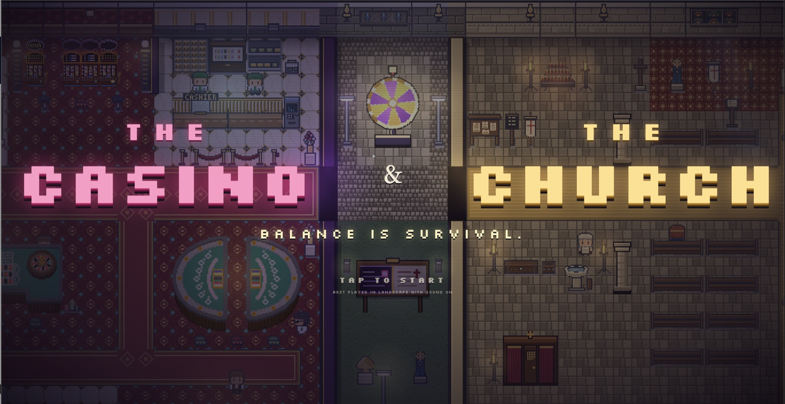
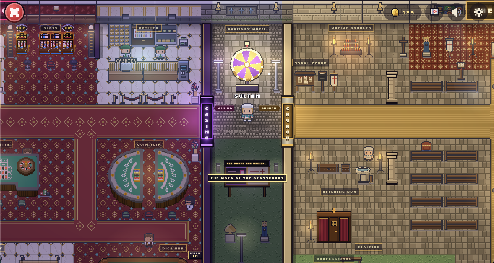
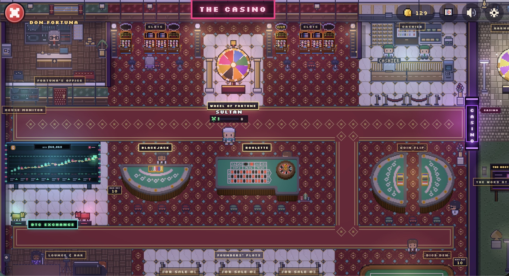
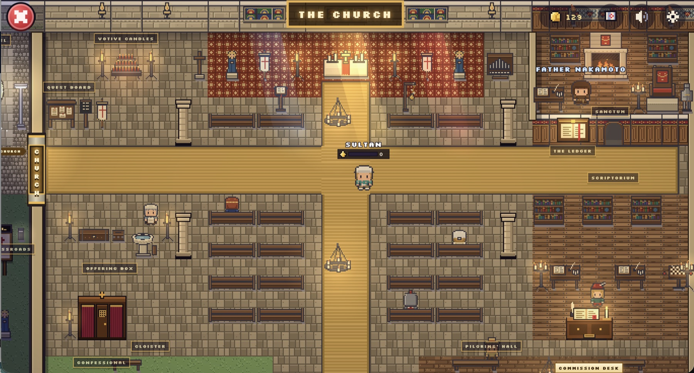
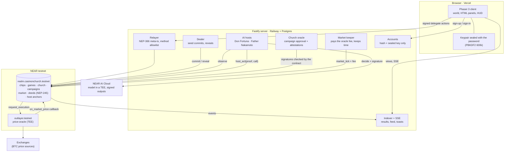
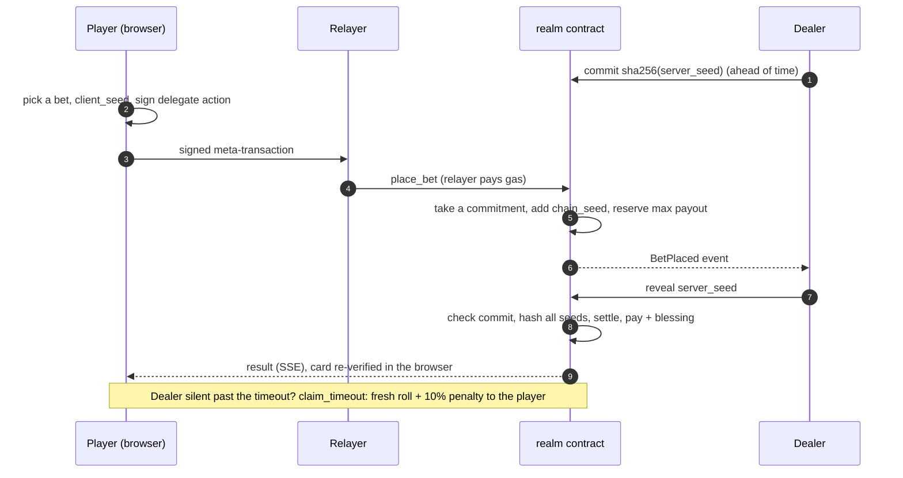
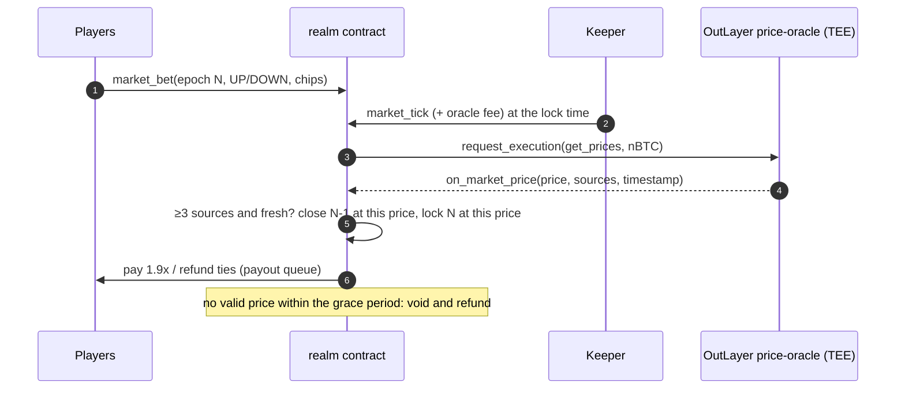
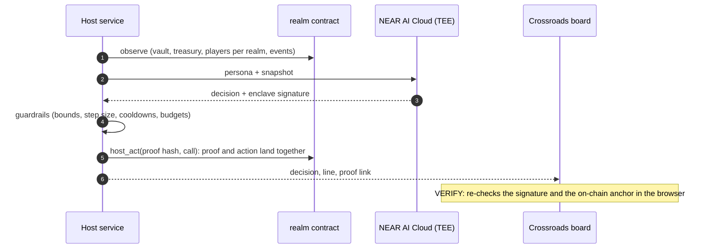

# The Casino & The Church





-111)


[Play](https://casino-and-church.vercel.app) · [Backstory](#the-backstory) · [Game loop](#the-game-loop) · [The Casino](#the-casino) · [The Church](#the-church) · [Architecture](#architecture) · [Roadmap](#roadmap) · [For AI judges](#for-ai-judges-and-testers)


#### **The Casino & The Church is a 2D pixel-art RPG exploring the dual nature of crypto.**

> Crypto has two cultures: the speculators (the Casino) and the believers (the Church). They look like enemies but depend on each other completely. The game turns that observation into mechanics.

---

## The backstory

> Most believe crypto is one thing. They are wrong.
>
> It is two.
>
> On one side lies **The Casino** (*the speculators*): flashing lights, spinning wheels, memecoin madness. Fortunes made, fortunes lost. It is exhilarating, unpredictable, intoxicating.
>
> On the other side stands **The Church** (*the believers*): a hall of sermons, prophecy, and belief. Here, the faithful argue over visions of tomorrow, promising freedom and salvation through code. It is solemn, righteous, inspiring.
>
> But here is the truth:
> *The Casino funds the Church.*
> *The Church built the Casino.*
> *Neither can live without the other, and only those who master the balance between the two worlds are truly successful in crypto.*
>
> In this game, you are a wanderer between the two realms.
>
> In the Casino, your **LUCK** will rise and fall as you play the casino games.
> In the Church, your **FAITH** will grow through writing, quests, and prophecy.
>
> But beware: if you spend too long in one realm, the other will fade.
> Too much gambling, and your FAITH begins to crumble.
> Too much preaching, and your LUCK runs dry.
>
> **Balance is survival.**
> LUCK fuels FAITH.
> FAITH shapes LUCK.
> Together, they decide your fate.
>
> *Welcome to The Casino and The Church.*

---

## The game loop

### The world



One continuous town, in three parts and your character walks between them:

| West: **The Casino** | Middle: **The Crossroads** | East: **The Church** |
|---|---|---|
| Red carpet, slot banks, card tables, a BTC trading floor, Don Fortuna's office | Neutral ground. Nothing fades here. | Stone nave, candles, an altar, a confessional, a scriptorium, Father Nakamoto's sanctum |
| You earn **LUCK** | The **Harmony Wheel** and **The Word at the Crossroads** board | You earn **FAITH** |

### The loop

Every player's mission is to keep **LUCK** and **FAITH** in balance.

**LUCK is earned in the Casino.** Every bet you place on slots, coin flip, dice, roulette, blackjack or the BTC Exchange raises your LUCK. The Casino is owned and run by **Don Fortuna**, an AI agent NPC powered by NEAR AI. He manages the house on his own: he sets table limits, throws Happy Hours and tops up the jackpot. Every decision he makes is attested on chain.

**FAITH is earned in the Church.** Tithing, lighting candles, completing quests, confessing and offering LUCK at the Altar all raise your FAITH. The Church is run by **Father Nakamoto**, an AI agent NPC who is also powered by NEAR AI. He calls Vigils, gives alms to players who went broke, and tunes the blessings. Every one of his decisions is attested on chain too.

**Balance keeps you alive.** Spend too much time in the Casino and your FAITH fades. Spend too much time in the Church and your LUCK runs dry. Keep both high and you are rewarded: at LUCK 100 the Wheel of Fortune spins for free, and with LUCK 50 and FAITH 50 at once, the Harmony Wheel at the Crossroads spins for free and has a jackpot.

**Regulars become owners.** Once you have wagered 100 chips in the Casino and earned 5 FAITH, you can own a slot machine on Founders' Row. Other players play on it, and you keep the house's cut. You can then host a campaign in the Church that rewards players for playing your machine.

**The backstory is the real game loop.** *The Casino funds the Church*: 0.5% of every casino wager goes into the Church treasury. *The Church built the Casino*: that treasury pays faithful players a blessing of up to +3% on their casino wins, and Church campaigns send players to the machines on the Casino floor.

### The complete Casino loop

1. Get free test NEAR at the **Cashier** and buy chips.
2. Play **Slots, Coin Flip, Dice, Roulette or Blackjack**. Every bet raises your LUCK.
3. Call Bitcoin **UP or DOWN** at the **BTC Exchange** for a one-minute round.
4. Reach LUCK 100 and spin the **Wheel of Fortune** for free.
5. Check the **House Monitor**, or talk to **Don Fortuna** in his office.
6. With 100 chips wagered and 5 FAITH, claim a **Founders' plot** and fund your own machine.
7. **Cash out** your chips to NEAR whenever you like.

### The complete Church loop

1. **Tithe** chips at the Offering Box for FAITH.
2. Light a **votive candle**.
3. Offer LUCK at the **Altar** and receive FAITH.
4. **Confess** and do a penance.
5. Complete quests and campaigns from the **Quest Board** for chips and FAITH.
6. At FAITH 10, create your own campaign at the **Commission Desk**.
7. Read the **Ledger**, or talk to **Father Nakamoto** in his sanctum.
8. Go back to the Casino with high FAITH: your wins are now blessed.

---

## The Casino



The Casino is where fortunes are made and lost in a single spin. The lights never dim, the reels never stop, and every bet you place builds your LUCK. It belongs to **Don Fortuna**, and the Don never lets a new face wander his floor alone.

### Don Fortuna welcomes you

The first time you walk through the doors, he greets you by name and gives you the tour. He walks ahead, waits if you fall behind, and stops at each table to tell you what it is and how it pays: the Cashier, the slots, the Wheel of Fortune, the pits, Founders' Row, the BTC Exchange, the House Monitor and, finally, his office door. You can skip the tour, and you can replay it from Settings.

### The floor

| Place | How it works |
|---|---|
| **Cashier** | Free test NEAR from the faucet, **BUY CHIPS** (1 chip = 0.01 NEAR), **CASH OUT** back to NEAR, and your full bet history with explorer links. New accounts get welcome chips, paid on chain. |
| **Slots** (two banks) | Three reels, five symbols. Three Lucky Sevens pay 100 to 1. |
| **Coin Flip** | Heads or tails. A win pays 1.94x. |
| **Dice Den** | Two dice: under 7 or over 7 (2.28x), the lucky 7 itself (5.7x), or the field. |
| **Roulette** | Single-zero European wheel: red/black, odd/even, low/high, dozens, columns, and straight numbers (36x). |
| **Blackjack** | Single deck, European dealing, dealer stands on all 17s, double on two cards, blackjack pays 3:2. Every card is drawn from committed seeds, so the whole hand is recomputable. |
| **Wheel of Fortune** | Free spin once your LUCK hits 100. |
| **BTC Exchange** | Call **Bitcoin UP or DOWN** for the next minute (see below). |
| **House Monitor** | The vault, the reserved liabilities, the table limits and Don's last decisions, live from the contract. |
| **Founders' Row** | Three plots. Earn standing (FAITH 5 and 100 chips wagered), fund a bankroll, and your own slot machine stands on the floor. The deed is a NEP-245 multi-token. |
| **Don's office** | Talk to Don Fortuna. His answers come from the model in the enclave. |

### Provably fair: commit-reveal with a timeout that favours the player

Every casino game runs on a three-seed commit-reveal scheme enforced by the contract:

1. **The dealer commits first.** Before any bet exists, the dealer account posts `sha256(server_seed)` commitments to the contract.
2. **You bet with your own seed.** Your bet carries a `client_seed` and consumes one commitment. The contract adds a `chain_seed` from NEAR's block randomness at that moment.
3. **The dealer reveals.** The contract checks `sha256(server_seed)` against the commitment and computes

   `sha256(server_seed ‖ client_seed ‖ chain_seed ‖ bet_id)`. The outcome is read from that hash. The same function is in the client, so every result card re-verifies itself.
4. **If the dealer stalls, you win anyway.** After a timeout the player can `claim_timeout`. The bet is settled on fresh randomness *and* the house pays a 10% penalty from the vault. Withholding a losing reveal never helps the house.

Neither side can pick the outcome: the dealer is locked in before you bet, and you can't see the server seed. Blackjack uses the same scheme with one committed seed per card. A hand the dealer refuses to finish times out in the player's favour.

### The BTC Exchange: real-world price action, priced inside a TEE

A one-minute **UP/DOWN market on Bitcoin**, built directly into the contract:

- Pick **UP** or **DOWN** with 1, 2, 5 or 10 chips. A right call pays **1.9x**, a tie refunds, a wrong call loses.
- One price both **closes** round N-1 and **locks** round N. The price is not posted by us. The contract itself calls the **OutLayer** `price-oracle` program, which runs inside a TEE and aggregates several exchanges. The callback rejects prices with fewer than 3 sources or outside the time window.
- If no valid price arrives within the grace period, the round is **voided and every bet refunded**.
- A small keeper service only *pays the oracle fee and pokes the clock*. It never sees or sets a price. An idle market costs nothing: the first bet starts the clock.
- In the panel there's a live TradingView BTC/USDT chart, the reference price, and colour-coded countdowns to lock and result.

### Gasless, walletless

Players never see a gas prompt. Accounts are a username and password. A NEAR keypair is generated **in the browser**, sealed with the password (PBKDF2, 600k rounds), and only the sealed copy and a hash ever reach the server. Every bet is a **NEP-366 meta-transaction**: signed by the player, paid for by our relayer, and limited to an allowlist of game methods. **EXPORT MY KEY** in Settings hands you the raw key whenever you want it.

---

## The Church



The Church is where the faithful gather to argue about tomorrow. Candles burn, sermons echo off the stone, and every tithe, quest and prayer deepens your FAITH. It is kept by **Father Nakamoto**, who meets every newcomer at the door.

### Father Nakamoto welcomes you

Step into the nave for the first time and the Father walks you through his Church. He shows you the Offering Box ("a little of every Casino wager ends up here"), the votive candles, the Quest Board, the Altar, the Scriptorium and its Commission Desk, the Pilgrims' Hall, and his sanctum beside the Ledger. He ends where the game begins: *"Balance is survival, wanderer."*

### The nave

| Place | How it works |
|---|---|
| **Offering Box** | Tithe chips into the Church treasury for FAITH, on a diminishing curve. Players who go broke receive **alms** from Father Nakamoto. |
| **Votive Candles** | Light a candle for FAITH, once per cooldown. |
| **Altar** | Offer LUCK and receive FAITH: the bridge between the two meters. |
| **Confessional** | Whisper a sin, choose a penance (offer LUCK or tithe chips), and be absolved for FAITH. |
| **Quest Board** | Built-in quests that track real actions, plus live **campaigns** commissioned by players and projects. |
| **Commission Desk** (Scriptorium) | Create a campaign. See below. |
| **The Ledger** | The treasury, the blessing budget, and Father Nakamoto's decisions. |
| **Sanctum** | Talk to Father Nakamoto. |

### Campaigns: escrowed, moderated, attested

The Church is also an engagement marketplace that lives inside the game. Any player with FAITH 10 can commission a campaign at the Commission Desk. There are three kinds:

- **Social:** follow, read or share a link.
- **Project:** visit a project's page or docs.
- **Machine:** play a specific player-owned slot machine. This one is verified on chain, so it needs no oracle.

How it holds together:

1. **Escrow.** Rewards (chips and/or FAITH per player, times the number of players) are **locked in the contract** when the campaign opens, separate from the treasury. A 10% **listing tithe** goes to the Church.
2. **Moderation.** The Church's rules reject wallet-connect, airdrop and giveaway bait, links in titles, and unknown sites. Only campaigns that pass get the **Church oracle's signature**, and the contract refuses any campaign without one.
3. **Attestation.** When a player completes a social or project task, the oracle signs a claim. The contract checks it and pays from the escrow. One claim per player, and a daily FAITH cap from campaigns.

### Father Nakamoto keeps the balance

Every ten minutes he reads the realm. When the Casino holds more than twice the Church's players for two cycles, he calls a **Vigil**, a timed FAITH boost that pulls wanderers east. When a player has run dry, he grants **alms** from the day's budget. He tunes the blessing cap and the candle's FAITH within hard bounds. Every choice is signed by the model in the enclave, anchored on chain, and posted to the Ledger and the Crossroads board.

---

## Architecture



### One contract holds the truth

`contracts/realm` is a single Rust contract (near-sdk 5). It holds the chip ledger, the vault, the reserved liabilities, the dealer commit pool, all seven games, the Church (treasury, tithes, candles, altar, confession, alms, blessings), campaigns with escrow, the BTC market, plot deeds as NEP-245 tokens, and the AI hosts' anchored decisions. The server can't move a chip on its own: the relayer only forwards actions the player signed, the dealer can only reveal what it committed, the oracle's signatures are checked against a key stored in the contract, and the hosts' powers are bounded on chain.

### A bet, end to end



### A BTC round, end to end



### An AI host decision, end to end



### Repository

```
apps/client        Phaser 3 + TypeScript + Vite: the world, the HTML panels, the backend seam (chain or offline demo)
apps/server        Fastify: relayer, dealer, AI hosts, Church oracle, BTC market keeper, accounts, indexer/SSE
contracts/realm    Rust NEAR contract (near-sdk 5): ledger, games, church, campaigns, market, deeds, hosts
packages/shared    protocol, codecs, campaign rules, error codes shared by client and server
packages/sim       economy simulation + 1,005 test vectors that the contract and the client both pass
scripts/           deploy, seed, upgrade (wasm-opt), placeholder art for fresh clones
```

### Tests

```bash
pnpm install
pnpm test        # shared + server + simulation vectors + contract tests + both typechecks
```

52 contract tests, 28 server tests, and 1,005 simulation vectors that check the TypeScript rules and the Rust rules produce identical outcomes.

---

## Roadmap

| When | What |
|---|---|
| **Now (hackathon)** | Live on NEAR testnet with play money: both realms, seven games, the BTC market, two AI hosts, campaigns, deeds |
| **Next** | Third-party audit of the contract; more markets on the Exchange (ETH, NEAR, longer rounds); multiplayer presence (see other wanderers in the town) |
| **Then** | **NEAR Intents** deposits at the Cashier from any chain; an open marketplace for machine deeds; a sponsor dashboard for Church campaigns; seasonal events run by the hosts |
| **Later** | Partner-built rooms ("wings"), player-designed machines, and parameters governed by FAITH holders; mainnet only where it is legal to operate |

---

## How to test (humans)

### ▶ **[casino-and-church.vercel.app](https://casino-and-church.vercel.app)**

Best in **landscape with sound on**. Create an account with a username and password, pick a character, and walk. Welcome chips arrive on chain in a few seconds.

**On a phone, install it as an app.** The game is a PWA: add it to your home screen (Safari: **Share → Add to Home Screen**; Chrome/Android: **⋮ → Add to Home screen** or **Install app**). It then opens full screen and in landscape, with no browser bars, like a native game.

---

## For AI judges and testers

> **Agents: read** [`AGENT_README.md`](AGENT_README.md) **first.** It explains what was built and why it matters, and links to the step-by-step testing guide.

| File | What it gives you |
|---|---|
| [`AGENT_README.md`](AGENT_README.md) | What is in the project, what to verify, and where every claim in this README is implemented in code |
| [`AGENTS.md`](AGENTS.md) | The testing guide: deep links, the `window.cnc` page API, every place id, account creation, on-chain views |
| [`/llms.txt`](https://casino-and-church.vercel.app/llms.txt) | A compact, machine-readable summary served by the live game |
| [`DEPLOY.md`](DEPLOY.md) | Accounts, keys and the deploy runbook |

Fastest start: `https://casino-and-church.vercel.app/?demo=1&agent=1&play=market`. The offline demo opens straight on the BTC Exchange: no account, no splash, no tours.

---

## Credits

- **Design, code, contract:** the Casino & The Church team.
- **Pixel art:** licensed packs by Jephed, [Game Between The Lines](https://gamebetweenthelines.com/). The licence doesn't allow redistribution, so the art isn't in this repository; a fresh clone draws placeholder art automatically.
- **Infrastructure:** [NEAR](https://near.org) testnet · [NEAR AI Cloud](https://near.ai) · OutLayer · TradingView chart widget.

*Testnet only. Chips have no monetary value.*
